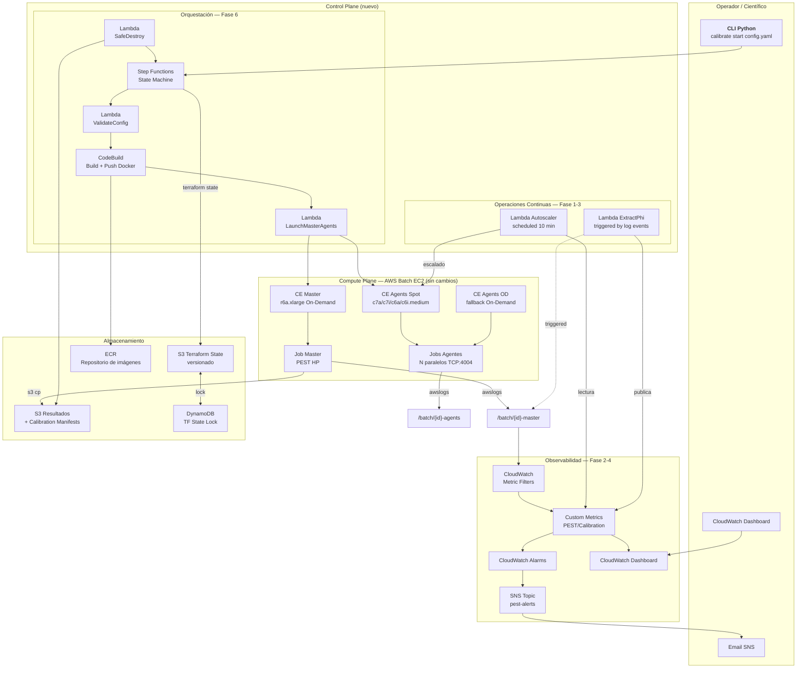
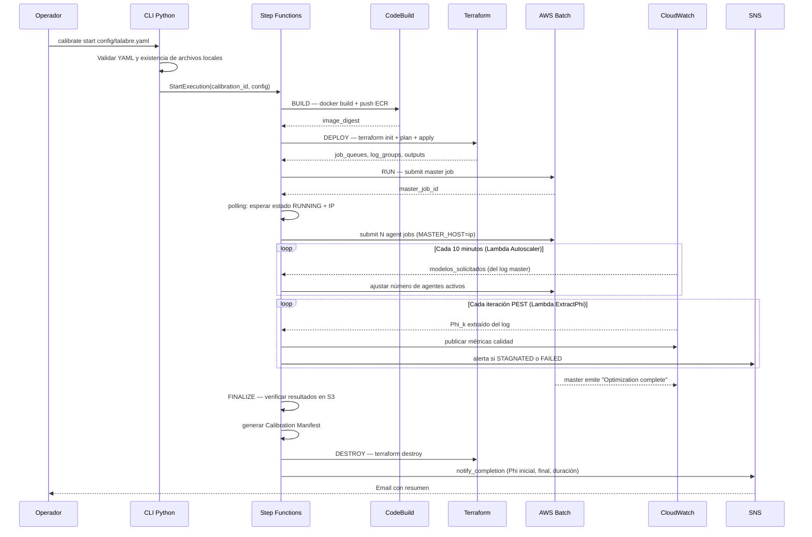

# Design Document: PEST Calibration Platform

## Overview

El **PEST Calibration Platform** es la evolución del sistema actual de calibración de modelos MODFLOW/PEST sobre AWS hacia una plataforma automatizada, observable y reproducible. El sistema actual requiere ~8 pasos manuales por calibración, depende de la laptop conectada del operador para el autoscaler, carece de alertas y no registra trazabilidad científica. Esta plataforma resuelve esos problemas progresivamente en seis fases, sin reemplazar el Compute Plane (AWS Batch EC2) que ya funciona correctamente.

El diseño separa el **Control Plane** (orquestación, monitoreo, ciclo de vida de infraestructura) del **Compute Plane** (ejecución real de PEST y el modelo numérico). El Compute Plane no cambia: los Compute Environments, Job Queues, Job Definitions, Launch Templates y entrypoints de contenedor están bien diseñados y se conservan. Solo se construye una capa de orquestación encima.

El MVP comprende las **Fases 0 y 1**: corregir los riesgos activos (bug de retry, state Terraform local, autoscaler dependiente del operador) sin agregar servicios innecesarios. Las fases posteriores agregan observabilidad, quality monitoring, y automatización completa de forma incremental, cada una condicionada a resolver las preguntas abiertas que la bloquean.

---

## Architecture

### Separación de Planos



### Flujo End-to-End (Estado Objetivo — Fase 6)



---

## Components and Interfaces

### Componente 1: CLI Python (`calibrate`)

**Propósito:** Punto de entrada único para operadores. Valida la configuración localmente antes de iniciar cualquier proceso en AWS.

**Interface:**

```python
# calibrate/cli.py
def cmd_start(config_path: str, dry_run: bool = False) -> CalibrationResult:
    """
    Carga config, valida, genera CalibrationId, inicia Step Functions.
    
    Preconditions:
      - config_path existe y es YAML válido
      - terraform_module existe en el repositorio
      - pst_file existe dentro de model.context_path
    
    Postconditions:
      - CalibrationId generado con formato CAL-{YYYYMMDD}-{NNN}
      - Step Functions execution iniciada o dry_run imprime el plan
    """

def cmd_status(calibration_id: str) -> CalibrationStatus:
    """Consulta estado de ejecución desde CloudWatch Metrics y Step Functions."""

def cmd_stop(calibration_id: str, force: bool = False) -> None:
    """
    Para la calibración: detiene jobs Batch, ejecuta safe_destroy si force=True.
    Sin force, solo detiene pero conserva infraestructura para inspección.
    """

def cmd_list(last_n: int = 10) -> list[CalibrationSummary]:
    """Lista las últimas N calibraciones desde S3 Manifests."""
```

**Responsabilidades:**
- Validar estructura y campos requeridos del `calibration.yaml`
- Verificar existencia de archivos referenciados (terraform_module, pst_file)
- Generar `CalibrationId` único con formato `CAL-{YYYYMMDD}-{NNN}`
- Invocar Step Functions o, en MVP (Fase 0-1), orquestar directamente

---

### Componente 2: Lambda Autoscaler

**Propósito:** Reemplaza el loop `while True` de `auto_scaling_tasks.py`. Ejecuta en AWS, sin dependencia del operador conectado. Reutiliza la lógica existente, parametrizada.

**Interface:**

```python
# lambdas/autoscaler/handler.py

def handler(event: dict, context: LambdaContext) -> AutoscalerResult:
    """
    Invocado por EventBridge cada 10 minutos.
    
    Preconditions:
      - calibration_id presente como variable de entorno o en event
      - CloudWatch log group del master existe y tiene datos recientes
    
    Postconditions:
      - Número de agentes RUNNING ajustado al número solicitado por PEST
      - Agentes que completaron su corrida terminados via batch.terminate_job()
      - Métrica ActiveWorkers publicada en PEST/Calibration
    """

def extract_models_requested(log_group: str, calibration_id: str) -> int:
    """
    Lee logs recientes del master.
    Busca: "Running model X times", "Calculating Jacobian matrix: running model X times"
    Retorna el máximo X encontrado en los últimos 15 minutos.
    
    Preconditions:  log_group accesible, tiene eventos en los últimos 60 min
    Postconditions: retorna 0 si no hay logs recientes (no lanzar más agentes)
    """

def get_active_agents(job_queue: str) -> list[str]:
    """
    Usa batch.list_jobs(jobQueue=job_queue, jobStatus='RUNNING').
    NO usa ECS API (bug actual en auto_scaling_tasks.py).
    """

def stop_completed_agents(job_queue: str, log_group_agents: str) -> int:
    """
    Termina agentes que emitieron "Model run complete" o "MODEL TIMEOUT".
    Usa batch.terminate_job() (no ecs.stop_task()).
    Retorna número de agentes terminados.
    """
```

**Responsabilidades:**
- Leer número de modelos solicitados desde logs del master en CloudWatch
- Comparar con agentes activos usando API de Batch (no ECS)
- Lanzar agentes adicionales si hay déficit
- Terminar agentes que completaron su corrida
- Detectar si el master falló (sin logs por >30 min) y publicar alerta

---

### Componente 3: Lambda ExtractPhiMetrics

**Propósito:** Extrae el Phi de cada iteración PEST desde CloudWatch Logs y lo publica como Custom Metric. Bloquea: OQ-03 (formato exacto del log).

**Interface:**

```python
# lambdas/extract_phi/handler.py

def handler(event: dict, context: LambdaContext) -> PhiExtractionResult:
    """
    Disparado por CloudWatch Logs subscription filter o EventBridge.
    
    Preconditions:
      - OQ-03 resuelto: formato de líneas Phi confirmado con log real
      - calibration_id disponible como dimensión del log group
    
    Postconditions:
      - Métricas PhiCurrent, PhiBest, PhiRelativeImprovement publicadas
      - CalibrationQualityState publicado (UNKNOWN/IMPROVING/SLOW/STAGNATED/CONVERGED)
    """

def extract_phi_from_events(events: list[LogEvent], phi_pattern: str) -> list[PhiReading]:
    """
    REQUIERE VALIDACIÓN (OQ-03):
    El patrón regex debe confirmarse con logs reales antes de implementar.
    Candidatos (a validar):
      r'Phi\\s*=\\s*([\\d\\.]+)'
      r'Objective function value:\\s*([\\d\\.]+)'
      r'Current phi\\s*=\\s*([\\d\\.]+)'
    """

def classify_quality_state(phi_history: list[float], config: QualityConfig) -> QualityState:
    """
    Clasifica estado de calibración según historia de Phi.
    
    Preconditions:
      - phi_history tiene al menos 1 elemento
      - config.stagnation_window y config.improvement_threshold son válidos
    
    Postconditions:
      - Retorna QualityState; CONVERGED solo si mensaje PEST explícito detectado
      - STAGNATED no detiene la calibración automáticamente (solo alerta)
    
    Loop invariant:
      Para toda ventana deslizante calculada: solo se usan las últimas N iteraciones
      donde N = config.stagnation_window_iterations
    """
```

---

### Componente 4: Script `safe_destroy.py`

**Propósito:** Wrapper para `terraform destroy`. Verifica que los resultados estén en S3 antes de destruir la infraestructura. Disponible desde Fase 1.

**Interface:**

```python
# scripts/safe_destroy.py

def safe_destroy(
    calibration_id: str,
    terraform_module: str,
    s3_bucket: str,
    force: bool = False
) -> DestroyResult:
    """
    Preconditions:
      - calibration_id sigue el patrón CAL-YYYYMMDD-NNN
      - terraform_module existe en el filesystem
      - AWS credentials válidas con permisos Terraform
    
    Postconditions:
      - Si s3_results_exist() es False y force=False: abort, no se destruye nada
      - Si s3_results_exist() es True: terraform destroy ejecutado, manifest generado
      - Si s3_results_exist() es True y force=True: destroy aunque no haya resultados
    
    Secuencia:
      1. Verificar resultados en S3: s3://{bucket}/calibrations/{id}/modelo/
      2. Exportar logs CloudWatch a S3: s3://{bucket}/calibrations/{id}/logs/
      3. Generar Calibration Manifest en S3
      4. Detener jobs Batch activos
      5. terraform destroy -auto-approve
      6. Verificar que no quedaron recursos huérfanos
    """

def s3_results_exist(bucket: str, calibration_id: str) -> bool:
    """
    Verifica existencia del prefijo s3://{bucket}/calibrations/{calibration_id}/modelo/
    con al menos un objeto.
    """

def verify_no_orphan_resources(project_name: str, region: str) -> OrphanCheckResult:
    """
    Post-destroy: verifica que no quedaron Batch CEs, Job Queues ni instancias EC2
    con tag CalibrationID={calibration_id} en estado activo.
    """
```

---

### Componente 5: Módulo `calibration_utils/`

**Propósito:** Biblioteca Python compartida. Elimina la duplicación de código entre `auto_scaling_tasks.py`, `launch_master_agents.py`, `backup_logs.py` y scripts de CloudWatch. Disponible desde Fase 6.

**Interface:**

```python
# calibration_utils/cloudwatch.py
def fetch_recent_events(log_group: str, minutes: int = 15) -> list[LogEvent]: ...
def parse_iso_timestamp(ts: str) -> datetime: ...
def clean_message(msg: str) -> str: ...

# calibration_utils/batch.py
def submit_master_job(job_queue: str, job_def: str, env_vars: dict) -> str: ...
def submit_agent_jobs(job_queue: str, job_def: str, n: int, master_ip: str) -> list[str]: ...
def wait_for_master_ip(job_id: str, timeout_s: int = 600) -> str | None: ...
def get_running_jobs(job_queue: str) -> list[BatchJob]: ...
def terminate_job(job_id: str, reason: str) -> None: ...

# calibration_utils/config.py
def load_calibration_config(path: str) -> CalibrationConfig: ...
def validate_calibration_config(config: CalibrationConfig) -> ValidationResult: ...
def generate_calibration_id() -> str: ...  # formato CAL-YYYYMMDD-NNN

# calibration_utils/manifest.py
def generate_manifest(calibration_id: str, config: CalibrationConfig, metrics: CalibrationMetrics) -> CalibrationManifest: ...
def save_manifest_to_s3(manifest: CalibrationManifest, bucket: str) -> str: ...

# calibration_utils/terraform.py
def read_terraform_outputs(module_path: str) -> dict: ...  # reemplaza múltiples parsers hcl2 duplicados
def run_terraform_apply(module_path: str, vars: dict) -> TerraformResult: ...
def run_terraform_destroy(module_path: str) -> TerraformResult: ...
```

---

## Data Models

### CalibrationConfig

```python
@dataclass
class CalibrationConfig:
    # metadata
    id: str                          # auto-generado si vacío: CAL-YYYYMMDD-NNN
    name: str                        # requerido
    description: str = ""

    # model
    pst_file: str                    # requerido, debe existir en context_path
    model_version: str = ""

    # pest
    executable_master: str = "./pest_hp"
    executable_agent: str = "./agent_hp"
    port: int = 4004
    command_master: str = "/h"
    command_agent: str = "/h"

    # compute
    region: str = "us-east-1"
    master_instance_types: list[str] = field(default_factory=lambda: ["r6a.xlarge", "r6i.xlarge"])
    agent_instance_types: list[str] = field(default_factory=lambda: ["c7a.medium"])
    initial_agents: int = 50
    max_agents: int = 300
    use_spot: bool = True

    # infrastructure
    terraform_module: str            # requerido
    s3_bucket: str                   # requerido
    ecr_image: str                   # requerido
    ttl_hours: int = 72

    # monitoring
    log_retention_days: int = 90
    alert_email: str = ""

    # quality (condicionado a OQ-07/OQ-08)
    stagnation_window_iterations: int = 5
    stagnation_threshold: float = 0.001
    improvement_threshold: float = 0.01

    # alerts
    notify_on_stagnated: bool = True
    notify_on_converged: bool = True
    notify_on_failed: bool = True
    notify_on_completed: bool = True
```

**Reglas de validación:**
- `pst_file` debe existir dentro del contexto Docker (`app/modelo/`)
- `terraform_module` debe existir como directorio en el repositorio
- `s3_bucket` debe ser accesible con escritura
- `initial_agents <= max_agents`
- `port` debe estar en rango 1024–65535
- `ttl_hours` debe ser > 0

---

### CalibrationManifest

```python
@dataclass
class CalibrationManifest:
    calibration_id: str              # CAL-YYYYMMDD-NNN
    status: ExecutionState           # COMPLETED / FAILED / CANCELLED
    created_at: str                  # ISO 8601
    started_at: str
    finished_at: str

    # reproducibilidad
    git_commit: str
    git_branch: str
    docker_image: str
    docker_image_digest: str         # digest inmutable, no solo :latest
    pest_version: str                # extraído del log, no hardcodeado
    terraform_version: str
    model_version: str
    configuration_hash: str          # SHA256 del calibration.yaml

    # cómputo
    worker_count: int
    cpu_per_worker: float
    memory_per_worker_gb: float

    # ubicación de resultados
    results_location: str            # s3://bucket/calibrations/{id}/modelo/
    logs_location: str               # s3://bucket/calibrations/{id}/logs/
    metrics_location: str            # s3://bucket/calibrations/{id}/metrics/

    # métricas científicas (condicionado a OQ-03)
    phi_initial: float = 0.0
    phi_final: float = 0.0
    phi_reduction_pct: float = 0.0
    total_iterations: int = 0
    total_model_runs: int = 0
    convergence_status: str = ""     # solo desde mensaje explícito PEST
```

---

### ExecutionState y QualityState

```python
class ExecutionState(Enum):
    CREATED = "CREATED"
    VALIDATING = "VALIDATING"
    BUILDING = "BUILDING"
    PROVISIONING = "PROVISIONING"
    STARTING = "STARTING"
    RUNNING = "RUNNING"
    FINALIZING = "FINALIZING"
    COMPLETED = "COMPLETED"
    FAILED = "FAILED"
    CANCELLING = "CANCELLING"
    CANCELLED = "CANCELLED"
    CLEANING = "CLEANING"
    CLEANED = "CLEANED"

class QualityState(Enum):
    """
    Solo válido durante ExecutionState.RUNNING.
    Transiciones permitidas: UNKNOWN → cualquiera; CONVERGED es terminal.
    STAGNATED genera alerta pero NO detiene la calibración.
    """
    UNKNOWN = 0
    IMPROVING = 1
    SLOW_IMPROVEMENT = 2
    STAGNATED = 3
    CONVERGED = 4
```

---

### Métricas CloudWatch (namespace: `PEST/Calibration`)

Dimensión común en todas las métricas: `CalibrationId`

| Métrica | Tipo | Descripción | Disponible desde |
|---------|------|-------------|-----------------|
| `MasterHealth` | Gauge | 1=healthy, 0=failed | Fase 2 |
| `ActiveWorkers` | Gauge | Agentes RUNNING en Batch | Fase 1 |
| `FailedWorkers` | Counter | Agentes en estado FAILED | Fase 2 |
| `CompletedRuns` | Counter | Corridas de modelo completadas | Fase 2 |
| `FailedRuns` | Counter | Corridas fallidas | Fase 2 |
| `PhiCurrent` | Gauge | Phi de la última iteración | Fase 2 (condicionado OQ-03) |
| `PhiBest` | Gauge | Mejor Phi histórico en esta corrida | Fase 2 |
| `PhiRelativeImprovement` | Gauge | Mejora relativa última iteración | Fase 3 |
| `CurrentIteration` | Gauge | Iteración PEST actual | Fase 2 |
| `CalibrationQualityState` | Gauge | 0–4 según QualityState enum | Fase 3 |
| `CalibrationProgress` | Gauge | % estimado 0–100 | Fase 3 |
| `CalibrationRuntime` | Gauge | Segundos desde inicio | Fase 2 |
| `EstimatedCost` | Gauge | USD acumulado estimado | Fase 5 |

---

## Pseudocódigo Algorítmico con Especificaciones Formales

### Algoritmo Principal: Autoscaler

```pascal
ALGORITHM autoscaler_cycle(calibration_id, config)
INPUT:  calibration_id: CalibrationId
        config: AutoscalerConfig (job_queue_agents, log_group_master,
                                   max_agents, calibration_id)
OUTPUT: AutoscalerResult (agents_launched, agents_stopped, master_healthy)

PRECONDITIONS:
  - calibration_id sigue formato CAL-YYYYMMDD-NNN
  - config.job_queue_agents existe en AWS Batch
  - config.log_group_master existe en CloudWatch

BEGIN
  // 1. Verificar salud del master
  last_master_event ← get_last_log_event(config.log_group_master)
  
  IF last_master_event IS NULL OR age(last_master_event) > 30 minutes THEN
    publish_metric("MasterHealth", 0, calibration_id)
    notify_alert(CRITICAL, "Master sin actividad por 30 min", calibration_id)
    RETURN AutoscalerResult(agents_launched=0, agents_stopped=0, master_healthy=False)
  END IF
  
  publish_metric("MasterHealth", 1, calibration_id)

  // 2. Extraer modelos solicitados (de logs recientes, NO de Phi)
  events ← get_recent_log_events(config.log_group_master, minutes=15)
  models_needed ← extract_models_requested(events)
  // Patrones: "Running model X times", "Calculating Jacobian matrix: running model X times"

  // 3. Contar agentes activos via Batch API (NO ECS API)
  active_agents ← list_running_jobs(config.job_queue_agents)
  agents_count ← LENGTH(active_agents)
  
  publish_metric("ActiveWorkers", agents_count, calibration_id)

  // 4. Ajustar número de agentes
  agents_to_launch ← 0
  IF models_needed > agents_count THEN
    gap ← models_needed - agents_count
    agents_to_launch ← MIN(gap, config.max_agents - agents_count)
    
    IF agents_to_launch > 0 THEN
      launch_agent_jobs(config.job_queue_agents, agents_to_launch, config.master_ip)
    END IF
  END IF

  // 5. Detener agentes que completaron (loop con invariante)
  agents_stopped ← 0
  
  FOR each agent IN active_agents DO
    // LOOP INVARIANT: agents_stopped <= número de agentes procesados hasta ahora
    agent_logs ← get_agent_logs(agent.job_id, config.log_group_agents)
    
    IF agent_completed(agent_logs) OR agent_timed_out(agent_logs) THEN
      terminate_job(agent.job_id, reason="Completed or timed out")  // batch API
      agents_stopped ← agents_stopped + 1
    END IF
  END FOR

  RETURN AutoscalerResult(
    agents_launched = agents_to_launch,
    agents_stopped = agents_stopped,
    master_healthy = True
  )
END

POSTCONDITIONS:
  - Si master healthy: ActiveWorkers métrica publicada
  - Si master unhealthy: alerta enviada, ningún cambio en agentes
  - agents_stopped ≤ LENGTH(active_agents) al inicio del ciclo
```

---

### Algoritmo: Clasificación de Calidad de Calibración

```pascal
ALGORITHM classify_calibration_quality(phi_history, convergence_msg_detected, config)
INPUT:  phi_history: List[Float]          -- Phi por iteración, ordenado cronológicamente
        convergence_msg_detected: Boolean  -- True si PEST emitió mensaje de convergencia
        config: QualityConfig              -- umbrales configurables (condicionado OQ-07/OQ-08)
OUTPUT: QualityState

PRECONDITIONS:
  - phi_history es lista ordenada con al menos 1 elemento
  - config.improvement_threshold > config.stagnation_threshold > 0
  - config.stagnation_window_iterations >= 2

BEGIN
  // CONVERGED solo desde mensaje explícito de PEST — NUNCA inferido numéricamente
  IF convergence_msg_detected THEN
    RETURN QualityState.CONVERGED
  END IF

  // Insuficientes datos
  IF LENGTH(phi_history) < 2 THEN
    RETURN QualityState.UNKNOWN
  END IF

  // Calcular mejoras relativas en ventana deslizante
  window_size ← MIN(config.stagnation_window_iterations, LENGTH(phi_history) - 1)
  recent ← phi_history[-(window_size + 1):]   // últimas window_size+1 iteraciones

  improvements ← []
  FOR i FROM 1 TO LENGTH(recent) - 1 DO
    // LOOP INVARIANT: improvements contiene solo valores calculados para iteraciones previas
    phi_prev ← recent[i - 1]
    phi_curr ← recent[i]
    
    IF phi_prev > 0 THEN
      rel_improvement ← (phi_prev - phi_curr) / phi_prev
      improvements.append(rel_improvement)
    END IF
  END FOR

  IF LENGTH(improvements) = 0 THEN
    RETURN QualityState.UNKNOWN
  END IF

  sliding_avg ← MEAN(improvements)

  // Clasificar — umbrales son configurables para validación experimental (OQ-07/OQ-08)
  IF sliding_avg > config.improvement_threshold THEN
    RETURN QualityState.IMPROVING
  ELSE IF sliding_avg > config.stagnation_threshold THEN
    RETURN QualityState.SLOW_IMPROVEMENT
  ELSE
    RETURN QualityState.STAGNATED
    // NOTA: STAGNATED solo genera alerta — NO detiene la calibración
  END IF
END

POSTCONDITIONS:
  - CONVERGED solo si convergence_msg_detected = True
  - STAGNATED nunca produce parada automática
  - resultado es consistente con la historia de Phi provista
```

---

### Algoritmo: Safe Destroy

```pascal
ALGORITHM safe_destroy(calibration_id, terraform_module, s3_bucket, force)
INPUT:  calibration_id: CalibrationId
        terraform_module: String (ruta al módulo Terraform)
        s3_bucket: String
        force: Boolean (destruir aunque no haya resultados confirmados)
OUTPUT: DestroyResult

PRECONDITIONS:
  - calibration_id sigue formato CAL-YYYYMMDD-NNN
  - terraform_module existe en el filesystem
  - Credenciales AWS activas con permisos: Batch, CloudWatch, S3, Terraform

BEGIN
  // 1. Verificar resultados en S3
  results_prefix ← "calibrations/" + calibration_id + "/modelo/"
  results_exist ← s3_prefix_has_objects(s3_bucket, results_prefix)
  
  IF NOT results_exist AND NOT force THEN
    LOG ERROR "Resultados no encontrados en S3 — abortando destroy"
    LOG ERROR "Usar --force para destruir de todas formas (riesgo de pérdida de datos)"
    RETURN DestroyResult(success=False, reason="NO_RESULTS_IN_S3")
  END IF

  // 2. Exportar logs a S3 antes de destruir
  logs_prefix ← "calibrations/" + calibration_id + "/logs/"
  export_cloudwatch_logs(LOG_GROUP_MASTER, s3_bucket, logs_prefix + "master/")
  export_cloudwatch_logs(LOG_GROUP_AGENTS, s3_bucket, logs_prefix + "agents/")

  // 3. Generar y guardar Calibration Manifest
  manifest ← generate_manifest(calibration_id, ...)
  save_manifest_to_s3(manifest, s3_bucket)

  // 4. Detener todos los jobs Batch activos
  stop_all_jobs(JOB_QUEUE_MASTER, reason="safe_destroy initiated")
  stop_all_jobs(JOB_QUEUE_AGENTS, reason="safe_destroy initiated")

  // 5. Terraform destroy
  TRY
    terraform_destroy(terraform_module)
  CATCH terraform_error
    LOG ERROR "terraform destroy falló: " + terraform_error
    LOG ERROR "Recursos a eliminar manualmente: " + list_active_resources(calibration_id)
    notify_alert(CRITICAL, "terraform destroy fallido — requiere limpieza manual", calibration_id)
    RETURN DestroyResult(success=False, reason="TERRAFORM_DESTROY_FAILED")
  END TRY

  // 6. Verificar que no quedaron recursos huérfanos
  orphans ← verify_no_orphan_resources(calibration_id)
  IF LENGTH(orphans) > 0 THEN
    LOG WARNING "Recursos huérfanos detectados: " + orphans
    notify_alert(WARNING, "Recursos huérfanos post-destroy", calibration_id)
  END IF

  RETURN DestroyResult(success=True, orphans=orphans)
END

POSTCONDITIONS:
  - Si success=True: manifest.yaml existe en S3, terraform destroy completado
  - Si success=False y NOT force: no se destruyó nada, estado AWS sin cambios
  - Si success=False y terraform_error: se notificó al operador con lista de recursos a limpiar
```

---

## Correcciones Críticas (Fase 0) con Especificaciones

### Fix F-02: Bug `$RETRY_CODE` → `$EXIT_CODE`

**Archivo:** `Estructura_Base/nombre_proyecto_modelo/app/entrypoint_agent.sh`

```bash
# ANTES (buggy) — $RETRY_CODE nunca se define:
if [ $RETRY_CODE -eq 80 ] || echo "wine: failed to map..." 2>&1 | grep -q "c0000018"; then

# DESPUÉS (correcto):
if [ $EXIT_CODE -eq 80 ] || echo "wine: failed to map..." 2>&1 | grep -q "c0000018"; then
```

**Precondición:** `$EXIT_CODE` se asigna como `EXIT_CODE=$?` después de ejecutar el agente.  
**Postcondición:** El mecanismo de retry se activa cuando el agente Wine retorna código 80 o el error `c0000018`.

---

### Fix F-01: Backend Terraform Remoto

**Archivo:** `backend.tf` (nuevo, en cada módulo activo)

```hcl
terraform {
  backend "s3" {
    bucket         = "${var.tf_state_bucket}"
    key            = "${var.project_name}/${var.region}/terraform.tfstate"
    region         = "us-east-1"
    dynamodb_table = "terraform-state-lock"
    encrypt        = true
  }
}
```

**Precondición:** Bucket S3 de state y tabla DynamoDB existen y son accesibles.  
**Postcondición:** `terraform.tfstate` nunca se almacena en disco local; cualquier miembro del equipo puede ejecutar `terraform destroy` con el mismo estado.

---

### Fix F-08: IAM S3 con Mínimo Privilegio

**Archivo:** `IaC_terraform/ModeloPest/talabre-linux/us-east-1/main.tf`

```hcl
# ANTES (wildcard — acceso a todos los buckets):
resource "aws_iam_role_policy" "task_role_s3" {
  policy = jsonencode({
    Statement = [{
      Resource = ["arn:aws:s3:::*", "arn:aws:s3:::*/*"]
    }]
  })
}

# DESPUÉS (restringido al bucket de la calibración):
resource "aws_iam_role_policy" "task_role_s3" {
  policy = jsonencode({
    Statement = [{
      Resource = [
        "arn:aws:s3:::${var.s3_bucket}",
        "arn:aws:s3:::${var.s3_bucket}/*"
      ]
    }]
  })
}
```

---

## Ejemplo de Uso: Flujo Completo MVP (Fases 0–1)

```python
# Uso desde línea de comandos — Fase 1 (sin Step Functions)
# $ python -m calibrate start config/talabre.yaml

# Internamente, calibrate/cli.py ejecuta:

config = load_calibration_config("config/talabre.yaml")
# → CalibrationConfig(name="talabre-pwadj", initial_agents=50, max_agents=300, ...)

validation = validate_calibration_config(config)
# → ValidationResult(valid=True)

calibration_id = generate_calibration_id()
# → "CAL-20261015-001"

# Build imagen Docker con SHA tag (Fix F-03 reproducibilidad)
image_tag = f"{config.ecr_image}:{git_sha[:8]}"
subprocess.run(["docker", "build", "-t", image_tag, "."])
subprocess.run(["docker", "push", image_tag])

# Deploy infraestructura con backend remoto (Fix F-01)
terraform_apply(config.terraform_module, vars={
    "project_name": config.name,
    "calibration_id": calibration_id,
    "ecr_image": image_tag,
})

# Lanzar master y agentes (reutiliza launch_master_agents.py refactorizado)
master_job_id = submit_master_job(config)
master_ip = wait_for_master_ip(master_job_id, timeout_s=600)
if master_ip is None:
    raise RuntimeError(f"Master {master_job_id} no obtuvo IP en 10 minutos")

agent_ids = submit_agent_jobs(config, master_ip, n=config.initial_agents)

# Autoscaler corre en Lambda cada 10 min (Fix F-03)
# → No requiere que el operador mantenga la laptop conectada

print(f"Calibración {calibration_id} iniciada")
print(f"Dashboard: https://{config.region}.console.aws.amazon.com/cloudwatch/...")
```

---

## Correctness Properties

*A property is a characteristic or behavior that should hold true across all valid executions of a system — essentially, a formal statement about what the system should do. Properties serve as the bridge between human-readable specifications and machine-verifiable correctness guarantees.*

### Property 1: CONVERGED requires an explicit PEST message

*For any* `phi_history` input of any length and any numeric content, `classify_calibration_quality(phi_history, convergence_msg_detected=False)` must not return `QualityState.CONVERGED`. `CONVERGED` is assigned if and only if `convergence_msg_detected=True`, which is triggered exclusively when the master log contains one of the explicit PEST convergence keywords: `RELPARCHG`, `PHIREDSTP`, `"Optimization complete"`, or `"optimization complete"`.

**Validates: Requirements 11.5**

### Property 2: STAGNATED never stops the calibration automatically

*For any* calibration in `QualityState.STAGNATED`, the Quality Engine must emit exactly one WARNING alert via SNS and must not call `batch:TerminateJob` on any agent, must not raise an exception, and must not modify the `ExecutionState`. The calibration continues running until the operator intervenes or PEST itself converges.

**Validates: Requirements 11.6**

### Property 3: safe_destroy preserves results before destroying infrastructure

*For all* invocations of `safe_destroy` where `s3_results_exist()` returns `False` and `force=False`: `DestroyResult.success = False`, `terraform destroy` is not called, and no AWS resource state is modified. Only explicit `force=True` overrides this gate.

**Validates: Requirements 9.1**

### Property 4: Autoscaler uses only the Batch API for job management

*For any* autoscaler cycle execution, all calls to list running agents use `batch:ListJobs` and all calls to stop agents use `batch:TerminateJob`. The ECS API (`ecs:ListTasks`, `ecs:StopTask`, `ecs:RunTask`) is never invoked by the Lambda_Autoscaler under any input condition.

**Validates: Requirements 8.3**

### Property 5: CalibrationId format is enforced across all components

*For any* call to `generate_calibration_id()`, the returned string must match the regular expression `^CAL-\d{8}-\d{3}$`. *For any* string consumed as a `CalibrationId` by any component (CLI, Lambda_Autoscaler, Safe_Destroy, Manifest), strings that do not match `^CAL-\d{8}-\d{3}$` must be rejected with a validation error.

**Validates: Requirements 5.1, 5.3**

### Property 6: CalibrationConfig validation rejects constraint violations

*For any* `CalibrationConfig` where `initial_agents > max_agents`, or `port` is outside 1024–65535, or `ttl_hours <= 0`, `validate_calibration_config()` must return `ValidationResult(valid=False)`. No constraint-violating configuration may reach any AWS API call.

**Validates: Requirements 6.2, 6.3, 6.4**

### Property 7: All published metrics carry the CalibrationId dimension

*For any* call to `cloudwatch:PutMetricData` made by any component of the Calibration_Platform, the metric data must include a `CalibrationId` dimension with a non-empty value. No metric is published to the `PEST/Calibration` namespace without this dimension.

**Validates: Requirements 10.1**

### Property 8: CalibrationManifest never uses :latest as image reference

*For any* generated `CalibrationManifest`, the `docker_image_digest` field must not contain the string `":latest"` and must match the format `sha256:[a-f0-9]{64}`. Every manifest must reference the immutable image digest, not a mutable tag.

**Validates: Requirements 13.3**

### Property 9: Config Parser round-trip preserves CalibrationConfig

*For any* valid `CalibrationConfig` object, serializing it to YAML then parsing the resulting YAML must produce a `CalibrationConfig` object equivalent to the original (all fields equal). No information is lost or mutated through a serialize → parse cycle.

**Validates: Requirements 12.3, 12.4**

## Error Handling

### Escenarios por Etapa

| Etapa | Error | Respuesta | Reversible |
|-------|-------|-----------|-----------|
| **VALIDATING** | YAML inválido o campo faltante | Abortar localmente, mensaje claro | Sí — sin AWS resources creados |
| **VALIDATING** | pst_file no existe en contexto | Abortar localmente | Sí |
| **BUILDING** | docker build falla | Abortar, no crear infraestructura | Sí |
| **PROVISIONING** | terraform apply falla parcialmente | Intentar `terraform destroy`, alertar | Posible — riesgo de huérfanos |
| **STARTING** | Master no obtiene IP en 10 min | Abort, safe_destroy, alerta CRITICAL | Sí |
| **RUNNING** | Master Job FAILED | Alerta CRITICAL, no auto-destroy | Manual — revisar logs |
| **RUNNING** | Agente Wine error c0000018 | Retry automático (Fix F-02) | Sí |
| **RUNNING** | STAGNATED detectado | Alerta WARNING, continuar ejecución | N/A — solo alerta |
| **FINALIZING** | Resultados no en S3 | No destruir, alerta CRITICAL | Manual |
| **DESTROYING** | terraform destroy falla | Listar recursos, alerta, guía manual | Manual — nunca perder state |

### Manejo del Estado Local del Operador (Fix F-03)

El autoscaler (Lambda) corre **independientemente** de la conectividad del operador:

```python
# ANTES — dependencia conexión local:
# while True:          ← se detiene si se cierra la laptop
#     autoscale()
#     time.sleep(600)

# DESPUÉS — Lambda triggered por EventBridge cada 10 minutos:
# El operador puede apagar su máquina; el autoscaler continúa en AWS
```

---

## Testing Strategy

### Unit Testing (Fase 6 — `calibration_utils/`)

**Framework:** `pytest` (el proyecto actualmente no tiene tests — F-11).

```python
# tests/test_quality_classifier.py
class TestQualityClassifier:
    def test_converged_requires_pest_message(self):
        """CONVERGED nunca se infiere numéricamente — solo desde mensaje PEST"""
        phi_history = [9000.0, 5000.0, 1000.0, 100.0, 1.0]
        assert classify(phi_history, convergence_msg=False) != QualityState.CONVERGED
        assert classify(phi_history, convergence_msg=True) == QualityState.CONVERGED

    def test_stagnated_does_not_stop_calibration(self):
        """STAGNATED genera alerta pero no excepción ni parada"""
        phi_history = [1000.0] * 10  # sin mejora
        result = classify(phi_history, convergence_msg=False)
        assert result == QualityState.STAGNATED
        # No debe lanzar excepción, solo retornar estado

    def test_insufficient_data_returns_unknown(self):
        assert classify([], convergence_msg=False) == QualityState.UNKNOWN
        assert classify([1000.0], convergence_msg=False) == QualityState.UNKNOWN
```

```python
# tests/test_safe_destroy.py
class TestSafeDestroy:
    def test_aborts_if_no_s3_results(self, mock_s3_empty):
        result = safe_destroy("CAL-20261001-001", "module/", "bucket", force=False)
        assert result.success == False
        assert result.reason == "NO_RESULTS_IN_S3"
        # terraform destroy NO debe haber sido llamado

    def test_proceeds_if_results_exist(self, mock_s3_with_results):
        result = safe_destroy("CAL-20261001-001", "module/", "bucket", force=False)
        assert result.success == True
```

```python
# tests/test_autoscaler.py
class TestAutoscaler:
    def test_uses_batch_api_not_ecs(self, mock_batch):
        """Verifica que se usa batch.list_jobs, no ecs.list_tasks"""
        run_autoscaler_cycle("CAL-20261001-001", config)
        mock_batch.list_jobs.assert_called()
        # mock_ecs.list_tasks NO debe ser llamado

    def test_does_not_launch_above_max(self, mock_batch_10_agents):
        config = AutoscalerConfig(max_agents=10)
        # Aunque PEST pida 50, no lanzar más de 10
        result = run_autoscaler_cycle("CAL-20261001-001", config)
        assert result.agents_launched <= 10
```

### Property-Based Testing (Fase 6)

**Framework:** `hypothesis`

```python
from hypothesis import given, strategies as st

@given(st.lists(st.floats(min_value=0.1, max_value=1e6), min_size=0, max_size=100))
def test_classify_always_returns_valid_state(phi_history):
    """Para cualquier historia de Phi, classify retorna un QualityState válido"""
    result = classify(phi_history, convergence_msg=False)
    assert result in QualityState

@given(st.lists(st.floats(min_value=0.1, max_value=1e6), min_size=2))
def test_converged_never_without_pest_message(phi_history):
    """CONVERGED nunca sin mensaje PEST, sin importar la historia de Phi"""
    result = classify(phi_history, convergence_msg=False)
    assert result != QualityState.CONVERGED
```

### Integration Testing

Los tests de integración validan la interacción con AWS usando recursos de prueba (LocalStack para Batch/CloudWatch, o una cuenta de staging).

**Casos clave:**
- `test_submit_and_wait_master_ip`: verifica que `wait_for_master_ip` obtiene IP via EC2 tags
- `test_terraform_backend_remote`: verifica que el state se escribe en S3 y no localmente
- `test_autoscaler_lambda_invocation`: verifica que la Lambda se invoca y publica métricas

---

## Consideraciones de Seguridad

### Cambios de Fase 0 (correcciones inmediatas)

| Problema | Fix | Finding |
|----------|-----|---------|
| S3 wildcard en IAM task role | Restringir a `arn:aws:s3:::${bucket}` y `arn:aws:s3:::${bucket}/*` | F-08 |
| VPC IDs hardcodeados en `variables.tf` | Mover a `terraform.tfvars` excluido de `.gitignore` | F-05 |
| Account ID en scripts versionados | Reemplazar por `$(aws sts get-caller-identity --query Account --output text)` | F-04 |
| KMS Decrypt wildcard en gen1 | Limitar a ARN de clave específica o eliminar permiso | F-19 |

### Principios de diseño en componentes nuevos

- **Lambda Autoscaler:** Permisos IAM mínimos — solo `batch:ListJobs`, `batch:SubmitJob`, `batch:TerminateJob`, `cloudwatch:PutMetricData`, `logs:GetLogEvents`
- **Lambda ExtractPhi:** Solo necesita `logs:FilterLogEvents` y `cloudwatch:PutMetricData`
- **CLI local:** Nunca almacena credenciales — usa AWS credentials chain (env vars, ~/.aws/credentials, EC2 instance role)
- **Calibration Manifest:** Nunca incluye secretos, tokens ni credenciales — solo metadatos y ubicaciones S3
- **IMDSv2:** Ya requerido en Launch Templates actuales — mantener en nuevos módulos

---

## Consideraciones de Performance

### Latencia del Autoscaler (Fase 1)

El autoscaler Lambda con ciclo de 10 minutos puede causar hasta 10 min de subprovisión si PEST pasa de una fase de Jacobiano (~400 corridas) a búsqueda de lambda (~50 corridas) abruptamente. Este trade-off es aceptable vs. el riesgo actual (autoscaler cae con la laptop del operador).

Para reducir la latencia: el período configurable (default 10 min) puede reducirse a 5 min si el costo de invocaciones Lambda es aceptable (~$0.0000002 por invocación = despreciable).

### CloudWatch Metric Filters (Fase 2)

Los Metric Filters son procesados en tiempo real por CloudWatch sin costo adicional más allá del ingestion de logs. No hay latencia adicional.

### Step Functions (Fase 6)

La State Machine añade ~200ms de latencia por transición de estado, lo cual es despreciable en comparación con los tiempos de build Docker (~5-10 min) y terraform apply (~3-5 min).

---

## Consideraciones de FinOps

### Recursos Permanentes (costo fijo, no crece con calibraciones)

| Recurso | Costo estimado/mes |
|---------|-------------------|
| S3 Terraform State + versionado | <$1 |
| DynamoDB State Lock (on-demand) | <$1 |
| Lambda Autoscaler (idle) | $0 |
| EventBridge rules | $0 |
| SNS Topic (pocos mensajes) | <$1 |

### Recursos por Calibración (solo durante ejecución)

| Recurso | Costo |
|---------|-------|
| Master r6a.xlarge On-Demand | ~$0.26/h |
| 50 agentes c7a.medium Spot | ~$0.016/h × 50 = ~$0.80/h |
| CloudWatch Logs ingestion | ~$0.50/GB |

### Prototipos con NAT Gateway (OQ-01 — verificar urgente)

Si los módulos `Multiple_Region` o `unica_region_EC2` están desplegados: $32–$96/mes en NAT Gateways **sin ejecutar ninguna calibración**. Validar en consola AWS como Fase 0 (QW-06).

---

## Dependencias

### Python (Control Plane)

```toml
# pyproject.toml (unificado — Fix F-12)
[project]
dependencies = [
    "boto3>=1.34.0,<2.0",
    "pyyaml>=6.0,<7.0",
    "python-hcl2>=4.3,<5.0",
    "click>=8.1,<9.0",
    "rich>=13.0,<14.0",        # output CLI
]

[project.optional-dependencies]
test = [
    "pytest>=8.0,<9.0",
    "pytest-mock>=3.14,<4.0",
    "hypothesis>=6.100,<7.0",
    "moto[batch,cloudwatch,s3,logs]>=5.0,<6.0",  # AWS mocks
]
```

### Infraestructura

- Terraform >= 1.6.0 (ya requerido en módulos gen2)
- Docker (build local hasta Fase 6; luego CodeBuild)
- AWS CLI >= 2.0

### Servicios AWS (todos en cuenta existente)

- **Existentes:** AWS Batch, CloudWatch Logs, S3, ECR, IAM, VPC
- **Nuevos Fase 0:** S3 bucket para Terraform state, DynamoDB tabla para locks
- **Nuevos Fase 1:** Lambda, EventBridge
- **Nuevos Fase 2:** CloudWatch Alarms, SNS, CloudWatch Metric Filters
- **Nuevos Fase 4:** CloudWatch Dashboards
- **Nuevos Fase 6:** Step Functions, CodeBuild

---

## Preguntas Abiertas que Bloquean Fases Específicas

> Estas preguntas no pueden responderse analizando el repositorio. Requieren validación del equipo.

### OQ-03 — Formato de líneas Phi en los logs del master *(bloquea Fases 2–3)*

El diseño de Lambda ExtractPhiMetrics y los CloudWatch Metric Filters dependen de conocer el patrón regex exacto de las líneas Phi en el stdout de `pest_hp`. Los candidatos son:

```
Phi = 8432.50
Current phi = 6234.80
Objective function value: 8432.50
```

**Acción requerida:** Obtener un log real del master de una calibración anterior desde CloudWatch Logs y confirmar el formato exacto antes de implementar Fase 2.

---

### OQ-07 — Duración típica de una calibración *(bloquea umbrales de TTL)*

El valor `ttl_hours` en `calibration.yaml` y las alarmas de "infraestructura activa demasiado tiempo" dependen de saber cuánto tardan realmente las calibraciones de Talabre y CMDIC.

**Acción requerida:** Revisión del histórico de calibraciones antes de definir `ttl_hours` como default razonable (actualmente propuesto: 72h).

---

### OQ-08 — Iteraciones típicas hasta convergencia *(bloquea `stagnation_window_iterations`)*

El parámetro `stagnation_window_iterations` (default: 5) debe validarse experimentalmente. Si los modelos típicamente convergen en 8–10 iteraciones, una ventana de 5 es razonable; si convergen en 100+, es demasiado agresiva.

**Acción requerida:** Calcular retroactivamente el clasificador sobre el histórico de logs antes de activar alertas de STAGNATED en producción (Fase 3.5 del roadmap).

---

### OQ-01 — NAT Gateways de prototipos *(urgente — posible costo activo)*

Verificar en consola AWS si los módulos `Multiple_Region` o `unica_region_EC2` tienen infraestructura desplegada. Si sí, ejecutar `terraform destroy` inmediatamente.

**Costo potencial si activos:** $32–$96/mes sin ejecutar ninguna calibración.
