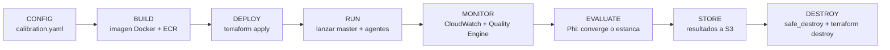

# Guía Paso a Paso — Plataforma de Calibraciones PEST en AWS

> Guía reproducible para ejecutar una calibración PEST de un modelo
> hidrogeológico MODFLOW en AWS, de principio a fin.
>
> **Dirigida a dos públicos:** el equipo de **Modelación** (que entrega e
> interpreta el modelo) y el equipo de **Tecnología** (que opera la
> infraestructura). Cada paso indica quién lo ejecuta.

---

## 1. Introducción

Esta plataforma automatiza la calibración de modelos PEST sobre AWS. En lugar de
operar manualmente servidores, el modelo se empaqueta en una imagen Docker, se
ejecuta en **AWS Batch** (que levanta y apaga las máquinas solo), y el avance se
observa en tiempo casi real desde CloudWatch.

La calibración corre en modo **Master-Agente**:

- El **master** (`pest_hp`) dirige el algoritmo de optimización: decide qué
  combinaciones de parámetros probar y mide qué tan bien el modelo reproduce las
  observaciones de campo (esa medida es **Phi**).
- Los **agentes** (`agent_hp`) ejecutan el modelo numérico en paralelo, cada uno
  en su propia máquina, y le devuelven resultados al master por el puerto TCP 4004.

### Flujo general



### Dos planos

| Plano | Qué hace | Dónde vive |
|-------|----------|-----------|
| **Control Plane** | Orquesta, monitorea, escala, destruye | `calibration_utils/`, `lambdas/`, `scripts/` (Python) |
| **Compute Plane** | Ejecuta PEST y el modelo | AWS Batch EC2 (master + agentes) |

> El Control Plane no cambia entre modelos. Lo que cambia por modelo es la
> **imagen Docker** (el modelo empaquetado) y el **calibration.yaml** (su
> configuración).

---

## 2. Roles y responsabilidades

| Actividad | Modelación | Tecnología |
|-----------|:----------:|:----------:|
| Entregar el modelo (`.pst`, `.tpl`, `.ins`, MODFLOW, binarios, scripts) | ✅ | |
| Definir parámetros, observaciones, pesos y criterios de convergencia en el `.pst` | ✅ | |
| Confirmar dimensionamiento (RAM, duración de una corrida, nº de parámetros) | ✅ | |
| Ajustar `calibration.yaml` (instancias, agentes, umbrales) | con apoyo | ✅ |
| Construir y publicar la imagen Docker | | ✅ |
| Desplegar la infraestructura (Terraform) | | ✅ |
| Lanzar la calibración | | ✅ |
| Monitorear la ejecución (fallos, costos, salud) | | ✅ |
| **Interpretar la evolución de Phi** (¿convergió? ¿se estancó? ¿es científicamente válido?) | ✅ | |
| Decidir si se detiene o continúa una calibración | ✅ | con apoyo |
| Respaldar resultados y destruir la infraestructura | | ✅ |
| Descargar e interpretar los resultados finales | ✅ | |

**Regla práctica:** Modelación responde "¿el resultado es bueno?"; Tecnología
responde "¿la infraestructura funciona y cuánto cuesta?".

---

## 3. Prerequisitos (una sola vez por máquina/colaborador)

### 3.1 Herramientas a instalar

| Herramienta | Para qué | Instalación (Windows) |
|-------------|----------|----------------------|
| AWS CLI v2 | Hablar con AWS | `winget install Amazon.AWSCLI` |
| Terraform >= 1.6 | Crear/destruir infraestructura | `winget install Hashicorp.Terraform` |
| Docker Desktop | Construir la imagen del modelo | docker.com (daemon debe estar corriendo) |
| 7-Zip | Descomprimir el modelo (`.rar`) | 7-zip.org |
| Python 3.12+ | Scripts del Control Plane | python.org o miniforge |

Dependencias Python del Control Plane:

```powershell
pip install -e ".[test]"
# o manualmente: pip install boto3 pyyaml python-hcl2 click rich
```

### 3.2 Configurar credenciales AWS

Pide a un administrador las access keys de un usuario IAM (ej. `flowhydro-poc`).
Luego:

```powershell
aws configure --profile flowhydro-poc
# AWS Access Key ID:     AKIA...        (empieza con AKIA, NO es una URL)
# AWS Secret Access Key: ...
# Default region name:   us-east-1
# Default output format: json
```

Verifica (debe mostrar tu Account ID, no un error):

```powershell
aws sts get-caller-identity --profile flowhydro-poc
```

> **Nota:** en todos los comandos de esta guía usamos el perfil `flowhydro-poc`.
> Si tu CLI quedó en el PATH como `aws`, úsalo directo; si no, la ruta completa es
> `C:\Program Files\Amazon\AWSCLIV2\aws.exe`.

### 3.3 Backend remoto de Terraform (ya desplegado)

El estado de Terraform se guarda en S3 con bloqueo en DynamoDB. **Ya está creado**
(no hay que hacer nada), pero para referencia son:

- Bucket de estado: `803037204233-pest-terraform-state`
- Tabla de bloqueo: `terraform-state-lock`

Si alguna vez hay que recrearlo (cuenta nueva): `cd IaC_terraform/bootstrap` ->
copiar `terraform.tfvars.example` a `terraform.tfvars`, completar, `terraform init
&& terraform apply`.

### 3.4 Aumento de cuota de vCPU EC2 (IMPORTANTE para el modelo real)

Las cuentas AWS nuevas vienen con cuota baja de vCPU On-Demand (típicamente 5) y a
veces restringidas a instancias Free Tier. El modelo real usa instancias de
producción (`r6a.xlarge` para el master, `c7a.medium` para los agentes), que
requieren más vCPUs.

**Solicita el aumento ANTES de desplegar** (AWS tarda de minutos a 1-2 días):

1. Consola AWS -> **Service Quotas** -> **Amazon EC2**
2. Busca **"Running On-Demand Standard (A, C, D, H, I, M, R, T, Z) instances"**
   (código `L-1216C47A`)
3. **Request quota increase** -> pide un valor acorde al número de agentes
   (ej. para 300 agentes c7a.medium = 300 vCPU, pide 350-400 con margen)
4. Para instancias Spot pide también el aumento del quota Spot correspondiente.

Verifica la cuota actual:

```powershell
aws service-quotas get-service-quota --service-code ec2 --quota-code L-1216C47A --region us-east-1 --profile flowhydro-poc --query "Quota.Value" --output text
```

---

## 4. Glosario rápido

| Término | Qué es (en simple) |
|---------|--------------------|
| **PEST** | El software que ajusta los parámetros del modelo para que reproduzca las observaciones. |
| **Phi (Φ)** | La "nota" del ajuste: suma de errores al cuadrado entre lo observado y lo simulado. **Menor Phi = mejor ajuste.** PEST busca minimizarlo. |
| **Master** | El cerebro de PEST (`pest_hp`): decide qué probar y evalúa Phi. Uno solo por calibración. |
| **Agente** | Un trabajador (`agent_hp`): corre el modelo con los parámetros que le pasa el master. Hay muchos en paralelo. |
| **Jacobiano** | Matriz de sensibilidad: PEST corre el modelo una vez por cada parámetro para ver cómo afecta a Phi. Con 15.116 parámetros, son miles de corridas por iteración (por eso hacen falta muchos agentes). |
| **Iteración** | Un ciclo completo de PEST: calcular Jacobiano -> proponer mejora -> evaluar. El modelo tiene NOPTMAX=20 (máx 20 iteraciones). |
| **MODFLOW-USG** | El modelo hidrogeológico numérico (`mfusgt270`) que simula el acuífero. |
| **CalibrationId** | Identificador único de cada corrida: `CAL-AAAAMMDD-NNN` (ej. `CAL-20261002-001`). |
| **Quality Engine** | Componente que lee el Phi de los logs y clasifica el estado de la calibración. |
| **CONVERGED** | PEST declaró convergencia (emitió el mensaje). El ajuste matemático terminó bien. |
| **STAGNATED** | Phi dejó de mejorar pero PEST NO declaró convergencia. Puede ser mínimo local; requiere revisión de Modelación. **El sistema solo alerta, no detiene.** |

---

## 5. Paso a paso de una calibración

> Ejemplo con el modelo **CMDIC Rajos**. Los comandos son para PowerShell en
> Windows. Reemplaza valores entre `<...>` por los reales.

Variables de referencia usadas en los comandos:

```powershell
$aws     = "C:\Program Files\Amazon\AWSCLIV2\aws.exe"
$env:AWS_PROFILE = "flowhydro-poc"
$env:AWS_PAGER   = ""
$ACCOUNT = "803037204233"
$REGION  = "us-east-1"
$PROYECTO = "cmdic-rajos"
```

### Paso 1 — Recibir y colocar el modelo  (Modelación entrega, Tecnología coloca)

El modelo llega comprimido (ej. `pest_ensi_v13.rar`, ~635 MB). Descomprímelo y
copia TODO su contenido dentro de `calibrations/cmdic-rajos/app/modelo/`.

```powershell
$sz = "C:\Program Files\7-Zip\7z.exe"
& $sz x "<ruta>\pest_ensi_v13.rar" "-o<ruta_temporal>" -y
# Copiar el contenido del modelo (los archivos, no la carpeta contenedora) a:
#   calibrations/cmdic-rajos/app/modelo/
```

**Verificar que están los archivos clave:**

```powershell
cd calibrations\cmdic-rajos\app\modelo
# Debe existir el control PEST, los binarios Linux y las utilidades Wine:
Get-ChildItem CMDIC_Rajos.pst, pest_hp, agent_hp, mfusgt270, model.sh, plproc.exe
```

> **Qué contiene el modelo CMDIC Rajos:**
> - Control PEST: `CMDIC_Rajos.pst` (15.116 parámetros, 243 observaciones, NOPTMAX=20)
> - Binarios Linux nativos: `pest_hp`, `agent_hp`, `mfusgt270`
> - Utilidades Windows (via Wine): `plproc.exe`, `usgbud2smp1.exe`, `usgmod2smp.exe`
> - Script de corrida: `model.sh` (lo invoca el `.pst` en cada evaluación)
> - El modelo NO se versiona en git (~4.5 GB); va solo en tu máquina.

### Paso 2 — Revisar el calibration.yaml  (Modelación + Tecnología)

El archivo `calibrations/cmdic-rajos/calibration.yaml` ya viene con el
dimensionamiento del modelo. Revísalo y ajusta si hace falta:

```yaml
name: cmdic-rajos
pst_file: CMDIC_Rajos.pst
master_instance_types: ["r6a.xlarge", "r6i.xlarge"]   # 32 GB RAM para el master
agent_instance_types: ["c7a.medium"]                   # 1 vCPU por agente
initial_agents: 50
max_agents: 300
ttl_hours: 96
alert_email: ""        # <-- completar con el email del operador
```

Validar la configuración (sin tocar AWS):

```powershell
cd c:\Users\Cesar\aws-calibracion\modflow-pest-calibracion
$env:PYTHONPATH="."
python -c "import yaml; from calibration_utils.config import CalibrationConfig, validate_calibration_config; c=CalibrationConfig(**yaml.safe_load(open('calibrations/cmdic-rajos/calibration.yaml',encoding='utf-8'))); r=validate_calibration_config(c); print('valida:', r.valid, r.errors)"
```

### Paso 3 — Construir la imagen Docker  (Tecnología)

La imagen empaqueta Ubuntu 24.04 + Wine + el modelo. Autentica Docker contra ECR
y construye.

> **Importante (lección de la POC):** en Windows, pasar el password de ECR por
> pipe directo falla con "400 Bad Request". Captura el token a variable primero.

```powershell
cd calibrations\cmdic-rajos

# 1. Login a ECR (token en variable, NO pipe directo)
$token = (& $aws ecr get-login-password --region $REGION).Trim()
$token | docker login --username AWS --password-stdin "$ACCOUNT.dkr.ecr.$REGION.amazonaws.com"

# 2. Tag por commit SHA (reproducibilidad: nunca solo :latest)
$SHA = (git rev-parse --short HEAD).Trim()
$IMG = "$ACCOUNT.dkr.ecr.$REGION.amazonaws.com/pest-$PROYECTO"

# 3. Build para linux/amd64 (Batch EC2 es amd64; --provenance=false evita manifests multi-arch)
docker build --platform linux/amd64 --provenance=false -t "${IMG}:$SHA" -t "${IMG}:latest" .
```

> El primer build tarda (instala Wine e inicializa el prefijo). La imagen será
> grande (~4.5 GB de modelo + Wine).

### Paso 4 — Crear el repo ECR y publicar  (Tecnología)

```powershell
# Crear el repositorio (solo la primera vez)
& $aws ecr create-repository --repository-name "pest-$PROYECTO" --region $REGION

# Publicar la imagen (ambos tags)
docker push "${IMG}:$SHA"
docker push "${IMG}:latest"
```

Anota el tag SHA: es el que irá en `calibration.yaml` (`ecr_image`) para
garantizar reproducibilidad.

### Paso 5 — Preparar la red y las variables de Terraform  (Tecnología)

La infraestructura necesita una VPC con subredes privadas y VPC Endpoints (sin
NAT Gateway, para no pagar costo fijo). En la POC creamos una VPC dedicada mínima
en `IaC_terraform/poc/network/`; para producción se usa el mismo patrón.

El módulo de Batch (`IaC_terraform/ModeloPest/talabre-linux/us-east-1/`) requiere
dos archivos locales (NO versionados):

**`terraform.tfvars`** (copia de `terraform.tfvars.example` y completa):

```hcl
vpc_id                  = "vpc-xxxxxxxx"
private_subnet_ids      = ["subnet-aaaa", "subnet-bbbb"]
private_route_table_ids = ["rtb-xxxxxxxx"]
s3_bucket_linux         = "803037204233-cmdic-rajos-results"
ecr_image_linux         = "803037204233.dkr.ecr.us-east-1.amazonaws.com/pest-cmdic-rajos:<SHA>"
```

**`backend.hcl`** (copia de `backend.hcl.example`):

```hcl
bucket         = "803037204233-pest-terraform-state"
key            = "pest-cmdic-rajos/us-east-1/terraform.tfstate"
region         = "us-east-1"
dynamodb_table = "terraform-state-lock"
encrypt        = true
```

### Paso 6 — Desplegar la infraestructura  (Tecnología)

```powershell
cd IaC_terraform\ModeloPest\talabre-linux\us-east-1
terraform init "-backend-config=backend.hcl"
terraform plan      # revisar qué va a crear
terraform apply     # confirmar
```

Esto crea: Compute Environments de Batch (Spot + On-Demand + master), Job Queues,
Job Definitions, Security Groups, IAM roles, Log Groups.

> **Costo:** la infraestructura en reposo cuesta casi nada; el gasto real empieza
> cuando se lanzan los jobs (instancias EC2).

### Paso 7 — Lanzar la calibración  (Tecnología)

El orquestador lanza el master, espera su IP y lanza los agentes:

```powershell
cd IaC_terraform\ModeloPest\talabre-linux\us-east-1
python launch_master_agents.py 50     # master + 50 agentes
```

A partir de aquí, el **Lambda Autoscaler** (que corre en AWS cada 10 min)
ajusta solo el número de agentes según lo que PEST pida en cada iteración.
No necesitas mantener tu máquina conectada.

> Para agregar más agentes a un master ya corriendo: `python launch_master_agents.py <N>`.
> Para solo lanzar el master y verificar antes: `python launch_master_agents.py 0 --master-only`.

### Paso 8 — Monitorear  (Tecnología; Modelación observa Phi)

Ver el estado del master en CloudWatch Logs:

```powershell
# Último log stream del master
& $aws logs describe-log-streams --log-group-name "/batch/pest-$PROYECTO-master" --region $REGION --order-by LastEventTime --descending --query "logStreams[0].logStreamName" --output text
```

Métricas en CloudWatch (namespace `PEST/Calibration`, dimensión `CalibrationId`):

| Métrica | Qué indica |
|---------|-----------|
| `MasterHealth` | 1 = sano, 0 = sin logs por 30 min (posible fallo) |
| `ActiveWorkers` | Agentes corriendo ahora |
| `PhiCurrent` | Phi de la última iteración |
| `PhiBest` | Mejor Phi alcanzado |
| `CurrentIteration` | Iteración actual (de 20) |
| `CalibrationQualityState` | 0=UNKNOWN, 1=IMPROVING, 2=SLOW, 3=STAGNATED, 4=CONVERGED |

Las alarmas SNS (si configuraste `alert_email`) te avisan por correo si el master
falla, si no hay actividad, o si la calibración se estanca (STAGNATED).

### Paso 9 — Interpretar los resultados  (Modelación)

Este paso es científico, lo lidera Modelación. El Quality Engine da una señal
automática, pero la decisión final es humana:

| Estado | Significado | Acción típica |
|--------|-------------|---------------|
| **IMPROVING** | Phi baja >1% por iteración | Dejar correr |
| **SLOW_IMPROVEMENT** | Phi baja entre 0.1% y 1% | Observar; evaluar si vale la pena seguir |
| **STAGNATED** | Phi casi no baja, SIN convergencia declarada | Revisar: ¿mínimo local? ¿parámetros topados? ¿pesos? |
| **CONVERGED** | PEST declaró convergencia (RELPARSTP/PHIREDSTP) | Aceptar resultados (previa revisión del Phi final) |

> **Clave:** CONVERGED solo se declara cuando PEST emite el mensaje explícito,
> nunca por adivinar del número. STAGNATED NO detiene la calibración
> automáticamente: solo alerta para que Modelación decida.

### Paso 10 — Respaldar y destruir  (Tecnología)

Al terminar (convergió, o Modelación decide parar), respalda y destruye para
dejar de pagar. El script `safe_destroy` verifica que los resultados estén en S3
ANTES de destruir:

```powershell
cd c:\Users\Cesar\aws-calibracion\modflow-pest-calibracion
$env:PYTHONPATH="."
python -m scripts.safe_destroy `
  --calibration-id CAL-20261002-001 `
  --terraform-module IaC_terraform/ModeloPest/talabre-linux/us-east-1 `
  --s3-bucket 803037204233-cmdic-rajos-results `
  --region us-east-1 `
  --log-group-master /batch/pest-cmdic-rajos-master
```

Si no hay resultados en S3 y no pasas `--force`, el script **aborta** y no
destruye nada (protección contra pérdida de datos). Luego descarga los resultados
desde S3 para Modelación:

```powershell
& $aws s3 cp "s3://803037204233-cmdic-rajos-results/calibrations/CAL-20261002-001/" "<carpeta_local>" --recursive
```

---

## 6. Monitoreo y métricas en detalle

El sistema expone dos capas de observabilidad: los **logs crudos** (lo que
imprime PEST y el modelo) y las **métricas custom** (números que el Control Plane
extrae de esos logs y publica en CloudWatch).

### 6.1 Logs en CloudWatch

| Log Group | Contenido |
|-----------|-----------|
| `/batch/pest-cmdic-rajos-master` | Salida del master `pest_hp`: iteraciones, Phi, mensajes de convergencia |
| `/batch/pest-cmdic-rajos-agent` | Salida de los agentes `agent_hp` y del modelo numérico |

Ver las últimas líneas del master en vivo:

```powershell
$grp = "/batch/pest-$PROYECTO-master"
$stream = (& $aws logs describe-log-streams --log-group-name $grp --region $REGION --order-by LastEventTime --descending --query "logStreams[0].logStreamName" --output text)
& $aws logs get-log-events --log-group-name $grp --log-stream-name $stream --region $REGION --limit 50 --query "events[*].message" --output text
```

> Hay scripts de ayuda en `Calibracion_Modelo_PEST/Cloudwatch/` (listar tasks,
> leer logs, consolidar) usados en el pipeline legacy; sirven de referencia.

### 6.2 Métricas custom (namespace `PEST/Calibration`)

Todas llevan la dimensión `CalibrationId`, así se pueden comparar varias
calibraciones en el mismo dashboard. La extracción la hace el Lambda
`extract_phi` leyendo el log del master y publicando con
`calibration_utils/metrics.py`.

| Métrica | Unidad | Significado | Fuente |
|---------|--------|-------------|--------|
| `MasterHealth` | 1/0 | ¿El master emitió logs en los últimos 30 min? | heartbeat de logs |
| `ActiveWorkers` | count | Agentes en estado RUNNING ahora | AWS Batch |
| `FailedWorkers` | count | Agentes que fallaron | AWS Batch |
| `PhiCurrent` | None | Phi de la última iteración | log del master |
| `PhiBest` | None | Mejor (menor) Phi hasta ahora | log del master |
| `CurrentIteration` | count | Iteración actual (de NOPTMAX=20) | log del master |
| `CalibrationQualityState` | 0-4 | Estado del Quality Engine | `quality.py` |
| `CalibrationRuntime` | seconds | Tiempo transcurrido | orquestador |

Mapa del valor de `CalibrationQualityState`:

| Valor | Estado |
|:-----:|--------|
| 0 | UNKNOWN (datos insuficientes, < 2 iteraciones) |
| 1 | IMPROVING |
| 2 | SLOW_IMPROVEMENT |
| 3 | STAGNATED |
| 4 | CONVERGED |

Consultar la última `PhiBest` de una calibración:

```powershell
& $aws cloudwatch get-metric-statistics `
  --namespace "PEST/Calibration" --metric-name PhiBest `
  --dimensions Name=CalibrationId,Value=CAL-20261002-001 `
  --start-time (Get-Date).AddHours(-24).ToString("yyyy-MM-ddTHH:mm:ssZ") `
  --end-time   (Get-Date).ToString("yyyy-MM-ddTHH:mm:ssZ") `
  --period 3600 --statistics Minimum --region $REGION
```

### 6.3 Alarmas y notificaciones

Si completaste `alert_email` en el `calibration.yaml`, Terraform crea un tópico
SNS y suscribe ese correo (confirma la suscripción desde tu email la primera vez).
Las alarmas definidas en `IaC_terraform/.../observability.tf` avisan cuando:

- **MasterHealth = 0** por 30 min -> el master puede haber muerto.
- **STAGNATED** sostenido -> para que Modelación revise (no detiene nada).
- Fallo masivo de agentes.

---

## 7. Troubleshooting (problemas frecuentes)

Lecciones recogidas durante la POC end-to-end. Antes de improvisar, revisa esta
tabla.

### 7.1 El job queda en RUNNABLE y nunca arranca

**Síntoma:** lanzas el job, aparece en estado `RUNNABLE` y se queda ahí.

**Causas y arreglo:**

1. **Cuota de vCPU insuficiente o tipo de instancia no permitido.** Las cuentas
   nuevas quedan restringidas a Free Tier y rechazan `t3.small`, `optimal`, etc.
   En la POC el fix fue usar `c7i-flex.large`. Para producción, **sube la cuota
   vCPU** (ver 3.4) y usa instancias de producción.
2. Revisa las *scaling activities* del Auto Scaling Group del Compute Environment:

   ```powershell
   & $aws autoscaling describe-scaling-activities --region $REGION --max-items 10 --query "Activities[*].[StatusCode,StatusMessage]" --output table
   ```

   Ahí AWS explica por qué no pudo lanzar la instancia (cuota, capacidad, AZ).

### 7.2 `docker login` a ECR falla con "400 Bad Request"

**Síntoma:** en Windows, el pipe directo del password a `docker login` falla.

**Arreglo:** captura el token en una variable primero (NO pipe directo del
comando):

```powershell
$token = (& $aws ecr get-login-password --region $REGION).Trim()
$token | docker login --username AWS --password-stdin "$ACCOUNT.dkr.ecr.$REGION.amazonaws.com"
```

### 7.3 La imagen corre local pero falla en Batch (exec format error)

**Causa:** se construyó para arquitectura equivocada o como manifest multi-arch.
Batch EC2 es **amd64**.

**Arreglo:** construye siempre con:

```powershell
docker build --platform linux/amd64 --provenance=false -t ... .
```

### 7.4 Scripts `.sh` fallan en el contenedor ("bad interpreter", `\r`)

**Causa:** archivos guardados con fin de línea Windows (CRLF). Bash en Linux no
los entiende.

**Arreglo:** el repo tiene `.gitattributes` que fuerza LF en `*.sh`, `*.py`,
`*.tf`. Si editas en Windows, verifica que el editor respete LF. Para convertir:

```powershell
(Get-Content archivo.sh -Raw) -replace "`r`n","`n" | Set-Content -NoNewline archivo.sh
```

### 7.5 Acentos corruptos en archivos (ó -> ó)

**Causa:** escribir archivos con `Get-Content -Raw` + `WriteAllText` sin encoding,
o con BOM.

**Arreglo:** escribe siempre UTF-8 **sin BOM**:

```powershell
$utf8 = New-Object System.Text.UTF8Encoding $false
[System.IO.File]::WriteAllText("ruta\archivo.md", $contenido, $utf8)
```

### 7.6 `terraform destroy` no borra el bucket S3

**Causa (esperada):** los buckets con objetos no se borran por protección. Es
intencional: no queremos perder resultados.

**Arreglo:** si de verdad quieres borrarlo, vacíalo primero y sácalo del state, o
déjalo (cuesta centavos). Para resultados, lo correcto es `safe_destroy`, que
confirma que los datos ya están respaldados.

### 7.7 No se puede recrear un Compute Environment ("in use")

**Causa:** el CE está asociado a una Job Queue activa.

**Arreglo:** primero deshabilita/borra la Job Queue, luego el Compute
Environment. En Terraform, el orden de dependencias suele resolverlo; si lo haces
a mano por consola, respeta ese orden.

### 7.8 El master arranca pero los agentes no se conectan

**Causas:** Security Group no abre el puerto TCP **4004** entre agentes y master,
o los agentes recibieron una IP de master incorrecta.

**Arreglo:** verifica el SG (regla de ingreso 4004 dentro de la VPC) y que
`launch_master_agents.py` haya resuelto la IP privada del master antes de lanzar
agentes.

---

## 8. FinOps — control de costos

La regla de oro: **la infraestructura en reposo no debe costar.** El gasto real
son las instancias EC2 mientras corre la calibración.

| Recurso | Costo en reposo | Notas |
|---------|-----------------|-------|
| VPC + Endpoints | casi $0 | sin NAT Gateway (decisión deliberada para evitar costo fijo) |
| ECR (imagen) | centavos/mes | ~4.5 GB almacenados |
| S3 (estado + resultados) | centavos/mes | versionado |
| DynamoDB (lock) | ~$0 | on-demand, poquísimas operaciones |
| Batch Compute Environments | $0 si min vCPU = 0 | solo pagan cuando hay jobs |
| EC2 (agentes + master) | **el gasto real** | solo mientras corre |

Buenas prácticas:

- **Spot para agentes** cuando el modelo tolere reinicios (PEST reencola el
  trabajo del agente perdido). On-Demand solo para el master.
- **Destruye siempre al terminar** (`safe_destroy` + `terraform destroy`). No
  dejes instancias "por si acaso".
- Pon un `ttl_hours` en `calibration.yaml` como red de seguridad.
- Revisa el costo acumulado en **Cost Explorer** filtrando por el tag del proyecto.

La POC completa end-to-end costó **menos de 1 USD**. El modelo real cuesta más
(instancias grandes y muchos agentes), pero el patrón de apagar todo al terminar
mantiene el gasto acotado a las horas de cómputo efectivas.

---

## 9. Reproducibilidad

El objetivo es que cualquier colaborador pueda **repetir exactamente** una
calibración o auditar una pasada: mismo modelo, misma imagen, misma config.

### 9.1 Calibration Manifest

Cada corrida se identifica con un **CalibrationId** `CAL-AAAAMMDD-NNN`
(ej. `CAL-20261002-001`) y debe quedar documentada con:

- **CalibrationId** y fecha
- **Commit SHA** del repo (`git rev-parse --short HEAD`)
- **Tag de la imagen Docker** (ese mismo SHA)
- Nombre y hash del `.pst` usado
- Contenido del `calibration.yaml`
- Resultado: Phi final, estado (CONVERGED/STAGNATED), nº de iteraciones
- Ubicación de los resultados en S3

### 9.2 Trazabilidad por SHA

La imagen Docker **siempre** se taggea con el commit SHA, no solo con `:latest`.
Así, `calibration.yaml` apunta a `pest-cmdic-rajos:<SHA>` y queda registrado qué
código y qué modelo produjeron un resultado dado. Nunca lances producción con
`:latest`.

### 9.3 Qué se versiona y qué no

| En git (versionado) | Fuera de git (local / S3) |
|---------------------|---------------------------|
| Dockerfiles, entrypoints (`app/*.sh`) | El modelo (`app/modelo/*`, ~4.5 GB) |
| `calibration.yaml` | `terraform.tfvars`, `backend.hcl` (secretos/infra) |
| Código del Control Plane (`calibration_utils/`, `lambdas/`, `scripts/`) | Resultados de corridas (van a S3) |
| IaC Terraform (`.tf`, `.example`) | `terraform.tfstate` (va al backend S3) |

El `.gitignore` de `calibrations/cmdic-rajos/` ya excluye `app/modelo/*`. El
estado de Terraform vive en el backend remoto S3 con bloqueo DynamoDB, nunca en
git.

### 9.4 Pipeline reproducible (resumen)

```
calibration.yaml (config)  +  modelo (app/modelo/)
        │
        ▼
  docker build  ──tag SHA──▶  ECR
        │
        ▼
  terraform apply (backend remoto S3)
        │
        ▼
  launch_master_agents.py  ──▶  Batch (master + agentes)
        │
        ▼
  CloudWatch (logs + métricas) ◀── extract_phi / quality
        │
        ▼
  resultados ──▶ S3 (CalibrationId)
        │
        ▼
  safe_destroy + terraform destroy
```

Cualquiera que tenga el commit SHA, el `calibration.yaml` y el modelo puede
reconstruir la imagen idéntica y repetir la calibración.

---

## 10. Referencias

Documentación del proyecto para profundizar:

| Documento | Qué contiene |
|-----------|--------------|
| `docs/auditoria/` (23 docs) | Auditoría técnica completa: hallazgos F-01..F-22, arquitectura objetivo, roadmap, open questions, quick wins |
| `docs/auditoria/23_phi_log_format_research.md` | Investigación del formato de log de Phi en PEST_HP (patrones regex del estado del arte) |
| `docs/poc/REPORTE_POC.md` | Reporte de la POC end-to-end en AWS (modelo dummy): qué se desplegó, resultados, costo, lecciones |
| `.kiro/specs/pest-calibration-platform/requirements.md` | 19 requisitos en formato EARS |
| `.kiro/specs/pest-calibration-platform/design.md` | Diseño con 9 correctness properties, planos Control/Compute |
| `.kiro/specs/pest-calibration-platform/tasks.md` | Plan de implementación por fases (0-6) |
| `calibrations/cmdic-rajos/README.md` | Especificidades del modelo CMDIC Rajos |

Software externo:

- [PEST / PEST_HP](https://pesthomepage.org/) — Doherty, documentación oficial
- [pyEMU](https://github.com/pypest/pyemu) — utilidades Python para PEST
- [MODFLOW-USG](https://www.usgs.gov/software/modflow-usg) — modelo numérico
- [AWS Batch](https://docs.aws.amazon.com/batch/) — orquestación de cómputo

---

*Guía mantenida por el equipo FlowHydro. Ante dudas sobre el modelo, consultar a
Modelación; sobre la infraestructura, a Tecnología.*
