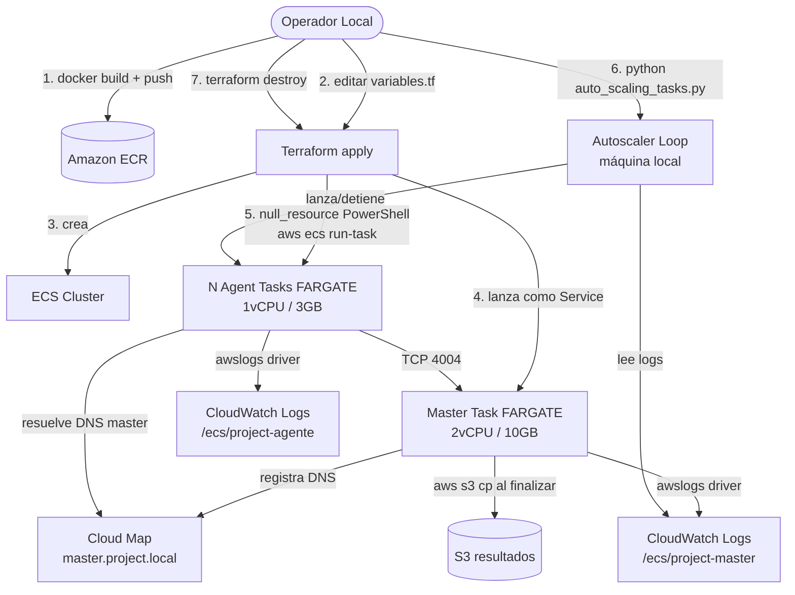
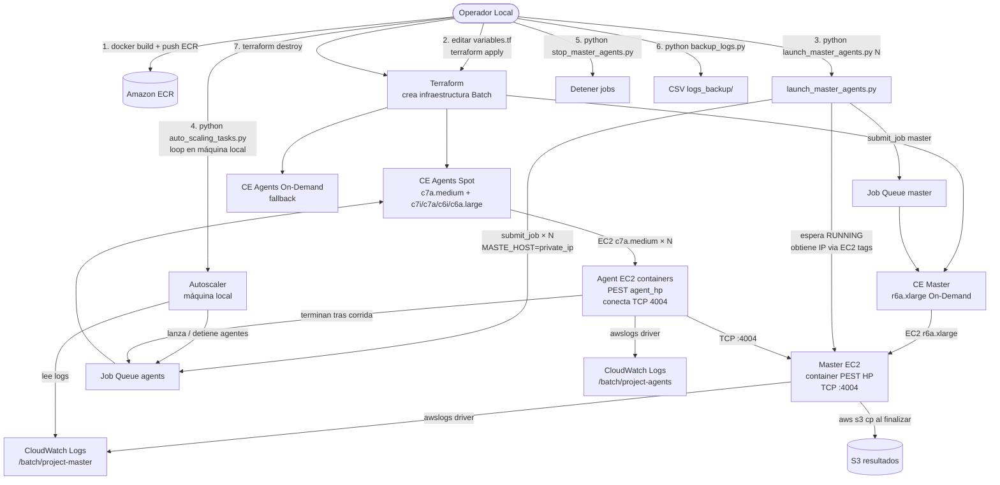
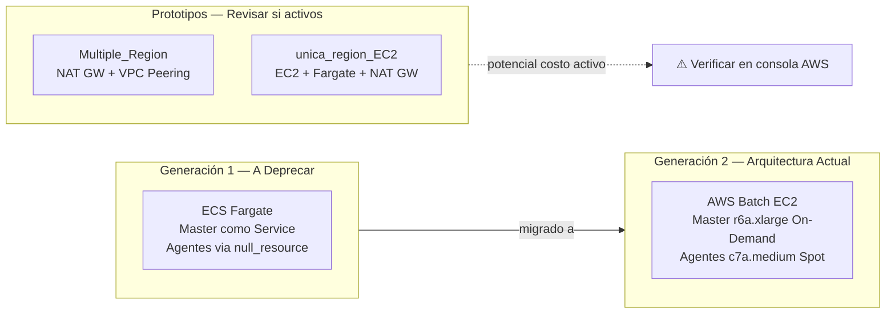

# Current Architecture

> Arquitectura reconstruida desde el código fuente. No se basa únicamente en los diagramas existentes.

---

## Realidad: Dos arquitecturas coexisten

El repositorio contiene **dos generaciones de arquitectura activas simultáneamente**. Esta situación genera confusión operacional y debe resolverse deprecando la generación 1.

---

## Generación 1 — ECS Fargate (a deprecar)

**Archivos:** `IaC_terraform/Arquitectura_regional/main.tf`, `IaC_terraform/ModeloPest/talabre/regional/main.tf`

### Componentes

| Componente | Recurso AWS | Detalle |
|------------|-------------|---------|
| Cluster ECS | `aws_ecs_cluster` | `{project}-cluster-{region}` |
| Task Definition Master | `aws_ecs_task_definition` | FARGATE, 2 vCPU / 10 GB, ephemeral 30 GB |
| Task Definition Agente | `aws_ecs_task_definition` | FARGATE, 1 vCPU / 3 GB |
| Service Master | `aws_ecs_service` | desired_count=1, Cloud Map DNS |
| Agentes (one-shot) | `null_resource` local-exec | PowerShell `aws ecs run-task` |
| Service Discovery | `aws_service_discovery_private_dns_namespace` | `{project}.local` |
| DNS Master | `aws_service_discovery_service` | `master.{project}.local` TTL=60s |
| SG Master | `aws_security_group` | TCP 4004 inbound desde agentes |
| SG Tasks | `aws_security_group` | Solo egress |
| SG Endpoints | `aws_security_group` | HTTPS 443 |
| VPC Endpoints | Interface + Gateway | ECR, STS, Logs, SSM, SSMMessages, EC2Messages, S3 |
| IAM ecsTaskExecution | `aws_iam_role` | AmazonECSTaskExecutionRolePolicy + ECR |
| IAM task_role | `aws_iam_role` | S3 Write + ECS Exec (SSM Messages) |
| CloudWatch Log Groups | `aws_cloudwatch_log_group` | `/ecs/{project}-master`, `/ecs/{project}-agente` |

### Flujo ECS Fargate (gen1)



### Problema principal gen1

El master se lanza como un **ECS Service** (always-running), lo que significa que si PEST termina o falla, ECS intenta reiniciar el contenedor automáticamente. El estado de PEST en disco efímero se pierde en cada restart. Los agentes se lanzan via `null_resource` con PowerShell, que no es idempotente ni portable.

---

## Generación 2 — AWS Batch EC2 (arquitectura actual)

**Archivos:** `IaC_terraform/ModeloPest/talabre-linux/us-east-1/main.tf`

### Componentes

| Componente | Recurso AWS | Detalle |
|------------|-------------|---------|
| **CE Spot agentes** | `aws_batch_compute_environment` | c7i/c7a/c6i/c6a.large, SPOT_CAPACITY_OPTIMIZED, max 2000 vCPUs |
| **CE On-Demand agentes** | `aws_batch_compute_environment` | Mismas familias, fallback, max 500 vCPUs |
| **CE Master** | `aws_batch_compute_environment` | r6a/r6i.xlarge, EC2 On-Demand, max 10 vCPUs |
| **CE Agentes On-Demand** | `aws_batch_compute_environment` | c7a.medium, On-Demand, max 1000 vCPUs |
| **Job Queue agents** | `aws_batch_job_queue` | Spot → OD fallback, priority=1 |
| **Job Queue master** | `aws_batch_job_queue` | Solo master CE |
| **Job Queue agents (M/A)** | `aws_batch_job_queue` | CE agentes On-Demand |
| **Job Def master** | `aws_batch_job_definition` | 4 vCPU / 30 GB RAM, retry=1, TCP 4004 portMapping |
| **Job Def agente** | `aws_batch_job_definition` | 1 vCPU / 1.6 GB, retry con eval_on_exit, timeout 36000s |
| **Job Def agente-stop** | `aws_batch_job_definition` | Agente con timeout corto para forzar parada |
| **Job Def autónomo** | `aws_batch_job_definition` | Para corridas sin master (testing) |
| **Launch Template batch** | `aws_launch_template` | 120 GB gp3 EBS, IMDSv2 required, hop_limit=2 |
| **Launch Template master** | `aws_launch_template` | 100 GB gp3 EBS, IMDSv2 required |
| **Launch Template agents** | `aws_launch_template` | 50 GB gp3 EBS, IMDSv2 required |
| **SG master** | `aws_security_group` | TCP 4004 inbound solo desde batch_instances SG |
| **SG batch_instances** | `aws_security_group` | Solo egress (agentes inician conexión al master) |
| **SG vpc_endpoints** | `aws_security_group` | HTTPS 443 desde VPC CIDR |
| **VPC Endpoints** | Interface + Gateway | ECS, ECS-agent, ECS-telemetry, ECR, Logs, SSM, S3 |
| **IAM batch_service_role** | `aws_iam_role` | AWSBatchServiceRole |
| **IAM batch_instance_role** | `aws_iam_role` | AmazonEC2ContainerServiceforEC2Role + SSMManagedInstanceCore |
| **IAM task_role** | `aws_iam_role` | S3 (⚠️ wildcard), SSM Messages, CloudWatch Logs |
| **CloudWatch Log Groups** | `aws_cloudwatch_log_group` | `/batch/{project}`, `/batch/{project}-master`, `/batch/{project}-agents` |

### Flujo AWS Batch EC2 (gen2)



### Discovery del master en gen2

La IP privada del master se obtiene consultando EC2 con el filtro `tag:Role=Master` y estado `running`. Se toma la instancia más reciente por `LaunchTime`. Esto reemplaza el mecanismo de Cloud Map DNS de gen1.

```python
# launch_master_agents.py
ec2_client.describe_instances(
    Filters=[
        {"Name": "tag:Role", "Values": ["Master"]},
        {"Name": "instance-state-name", "Values": ["running"]}
    ]
)
```

---

## Arquitecturas Adicionales (Prototipos)

### Multiple_Region — Multiregional con VPC Peering

**Archivo:** `IaC_terraform/ModeloPest/Multiple_Region/main.tf`

Master en EC2 (us-west-2), agentes Fargate en us-east-1 y us-east-2. Usa VPC Peering entre regiones y NAT Gateways (~$32/mes por región).

> ⚠️ **REQUIERE VALIDACIÓN:** ¿Está este stack actualmente desplegado? Si sí, hay costos fijos activos.

### unica_region_EC2 — EC2 + Fargate una región

**Archivo:** `IaC_terraform/ModeloPest/unica_region_EC2/main.tf`

Master en EC2 con Docker, agentes en Fargate. Incluye NAT Gateway, cron para sync S3, CloudWatch Agent. Prototipo de arquitectura híbrida.

> ⚠️ **REQUIERE VALIDACIÓN:** ¿Está este stack actualmente desplegado?

---

## Resumen Comparativo



---

## Networking — Diseño Actual (gen2)

El diseño de red en la generación actual es sólido:

- Contenedores en **subredes privadas** sin IP pública
- **VPC Endpoints Interface** para ECR, SSM, CloudWatch Logs, ECS
- **VPC Endpoint Gateway** para S3 (sin costo por GB)
- Sin NAT Gateway → sin costo fijo de red
- Security Groups mínimos: solo el puerto PEST (TCP 4004) y HTTPS (443) para endpoints
- **IMDSv2 required** en Launch Templates (buena práctica de seguridad)
- **EBS cifrado** en todos los volúmenes
