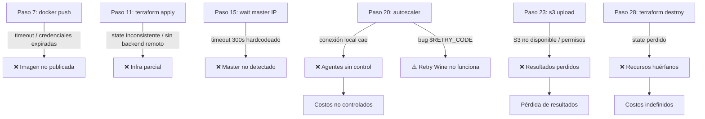

# Current Calibration Workflow

> Flujo real paso a paso para ejecutar una calibración en la arquitectura AWS Batch EC2 (gen2, la activa).

---

## Flujo Completo

| # | Paso | Quién | Archivo / Comando | Estado |
|---|------|-------|-------------------|--------|
| 1 | Recibir modelo de Modelamiento Numérico (.pst, .tpl, .ins, archivos MODFLOW) | Soporte TI | — | 🔴 MANUAL |
| 2 | Convertir `.bat` a `.sh` para Linux | Soporte TI | `app/ensibatch.sh` | 🔴 MANUAL |
| 3 | Ajustar `.pst` para llamar al `.sh` con `./` | Soporte TI | `app/modelo/*.pst` | 🔴 MANUAL |
| 4 | Copiar modelo a `app/modelo/` | Soporte TI | `Dockerfile` | 🔴 MANUAL |
| 5 | Revisar case-sensitivity de nombres en Linux | Soporte TI | — | 🔴 MANUAL |
| 6 | Construir imagen Docker | Soporte TI | `docker build` | 🔴 MANUAL |
| 7 | Autenticar en ECR y publicar imagen | Soporte TI | `AWS_ECR_carga_imagen_docker.ps1` | 🔴 MANUAL |
| 8 | Editar `variables.tf` (VPC, subnets, imagen, bucket) | Soporte TI | `variables.tf` | 🔴 MANUAL |
| 9 | `terraform init` | Soporte TI | CLI | 🔴 MANUAL |
| 10 | `terraform plan` (verificación) | Soporte TI | CLI | 🔴 MANUAL |
| 11 | `terraform apply` (crear infraestructura) | Soporte TI | CLI | ⚠️ SEMI-MANUAL |
| 12 | Esperar creación de infraestructura (~2-3 min) | — | — | ⏳ ESPERA |
| 13 | `python launch_master_agents.py <N>` | Soporte TI | `launch_master_agents.py` | ⚠️ SEMI-MANUAL |
| 14 | Script busca/lanza master en Batch | Auto | `launch_master_agents.py` | ✅ AUTO |
| 15 | Esperar master en RUNNING y obtener IP (~5-10 min) | — | `launch_master_agents.py` | ⏳ ESPERA |
| 16 | Script lanza N agentes con `MASTER_HOST=<ip>` | Auto | `launch_master_agents.py` | ✅ AUTO |
| 17 | Agentes ejecutan `entrypoint_agent.sh` → Wine → `agent_hp.exe` | Auto | `entrypoint_agent.sh` | ✅ AUTO |
| 18 | Master ejecuta `entrypoint_master.sh` → Wine → `pest_hp.exe` | Auto | `entrypoint_master.sh` | ✅ AUTO |
| 19 | PEST comienza calibración (iteración 1) | Auto | PEST | ✅ AUTO |
| 20 | `python auto_scaling_tasks.py` (loop manual) | Soporte TI | `auto_scaling_tasks.py` | 🔴 MANUAL |
| 21 | Autoscaler lee logs CloudWatch → ajusta agentes | Auto | `auto_scaling_tasks.py` | ✅ AUTO |
| 22 | PEST itera hasta convergencia o decisión del operador | Mixto | PEST | ⚠️ MIXTO |
| 23 | Al finalizar, master sube resultados a S3 | Auto | `entrypoint_master.sh` | ✅ AUTO |
| 24 | `python stop_master_agents.py` | Soporte TI | `stop_master_agents.py` | 🔴 MANUAL |
| 25 | `python backup_logs.py` (exportar logs a CSV) | Soporte TI | `backup_logs.py` | 🔴 MANUAL |
| 26 | `python analizar_agentes.py` (análisis Excel) | Soporte TI | `analizar_agentes.py` | 🔴 MANUAL |
| 27 | Descargar resultados desde S3 | Soporte TI | `aws s3 cp` | 🔴 MANUAL |
| 28 | `terraform destroy` | Soporte TI | CLI | 🔴 MANUAL |

**Pasos manuales totales: 14 de 28**

---

## Detalle de Etapas Clave

### Preparación del modelo (pasos 1–5)

El equipo de Modelamiento Numérico entrega:
- Archivo `.pst` (control file de PEST)
- Archivos `.tpl` (templates de parámetros)
- Archivos `.ins` (instrucciones de observaciones)
- Archivos del modelo MODFLOW (`.nam`, `.bas`, `.dis`, etc.)
- Script `.bat` con el comando de ejecución del modelo

Soporte TI convierte el `.bat` a un script `.sh` Linux (`ensibatch.sh`) y ajusta el `.pst` para que llame al nuevo script con `./`.

### Construcción de imagen Docker (pasos 6–7)

```bash
# Construir imagen
docker build -t pest-{proyecto}-linux:latest .

# Publicar en ECR
aws ecr get-login-password --region {region} | docker login --username AWS \
    --password-stdin {account}.dkr.ecr.{region}.amazonaws.com
docker tag pest-{proyecto}-linux:latest {account}.dkr.ecr.{region}.amazonaws.com/pest-{proyecto}-linux:latest
docker push {account}.dkr.ecr.{region}.amazonaws.com/pest-{proyecto}-linux:latest
```

> ⚠️ Siempre se publica con el tag `:latest`. No hay registro del digest de la imagen usada en cada calibración.

### Ejecución del master (paso 18)

El `entrypoint_master.sh` realiza:

1. Inicia Xvfb (display virtual para Wine)
2. Verifica que el ejecutable PEST existe
3. Ejecuta: `pest_hp.exe {modelo}.pst /h :{puerto}`
4. Captura exit code
5. Sube todo `/app/modelo` a S3 al finalizar (éxito o fallo)

### Ejecución de cada agente (paso 17)

El `entrypoint_agent.sh` realiza:

1. Inicia Xvfb (display virtual para Wine)
2. Verifica instalación de Wine
3. Verifica WINEPREFIX inicializado
4. Ping al master (diagnóstico de conectividad)
5. Ejecuta: `agent_hp.exe {modelo}.pst /h {master_ip}:{puerto}`
6. Loop de retry (máx. 2 intentos) ante error Wine c0000018 (**⚠️ bug activo: `$RETRY_CODE` no definido**)

### Autoscaling (paso 21)

El autoscaler (`auto_scaling_tasks.py`) opera en loop con estas acciones:

```
cada {minutes_wait_between_checks} minutos:
1. Lee variables.tf → región, proyecto
2. Lee terraform.tfstate → IDs de recursos
3. Obtiene stream más reciente del master en CloudWatch
4. Busca el último log con keywords: "Running model", "Calculating Jacobian matrix"
5. Extrae N (número de modelos a ejecutar) del mensaje
6. Consulta ECS/Batch por número de agentes RUNNING
7. Si N > agentes_activos → lanzar más agentes
8. Si agentes completaron corrida o sin logs → detenerlos
9. Exporta CSV de revisión a log_autoscaling/
```

> ⚠️ El autoscaler llama a `launch_master_agents.py` como subprocess para agregar agentes. También llama a `ecs.stop_task()` para detener agentes (API ECS, no Batch), lo que puede generar inconsistencias.

---

## Puntos de Falla



---

## Tiempo Estimado por Etapa

| Etapa | Tiempo estimado | Observaciones |
|-------|----------------|---------------|
| Preparación modelo | 1–4 horas | Depende de complejidad |
| Build + push Docker | 15–45 min | Primera vez más lento |
| terraform apply | 3–8 min | Depende de VPC endpoints |
| Master startup | 5–10 min | Boot EC2 + pull imagen + Wine init |
| Calibración | Horas a días | Depende del modelo |
| backup + destroy | 15–30 min | — |
| **Total operacional** | **~1 hora** | Por calibración, sin contar el tiempo de PEST |

---

## Comandos de Referencia

```bash
# Lanzar master + 50 agentes
python launch_master_agents.py 50

# Solo lanzar master (para verificar antes de agregar agentes)
python launch_master_agents.py 0 --master-only

# Agregar agentes a master existente
python launch_master_agents.py 20

# Lanzar con Jacobiano activado
python launch_master_agents.py 50 --jco

# Detener todos
python stop_master_agents.py

# Solo detener agentes (dejar master)
python stop_master_agents.py --agents

# Backup de logs
python backup_logs.py
python backup_logs.py --desde 2026-08-01
python backup_logs.py --horas 24

# Análisis de agentes
python analizar_agentes.py
```
