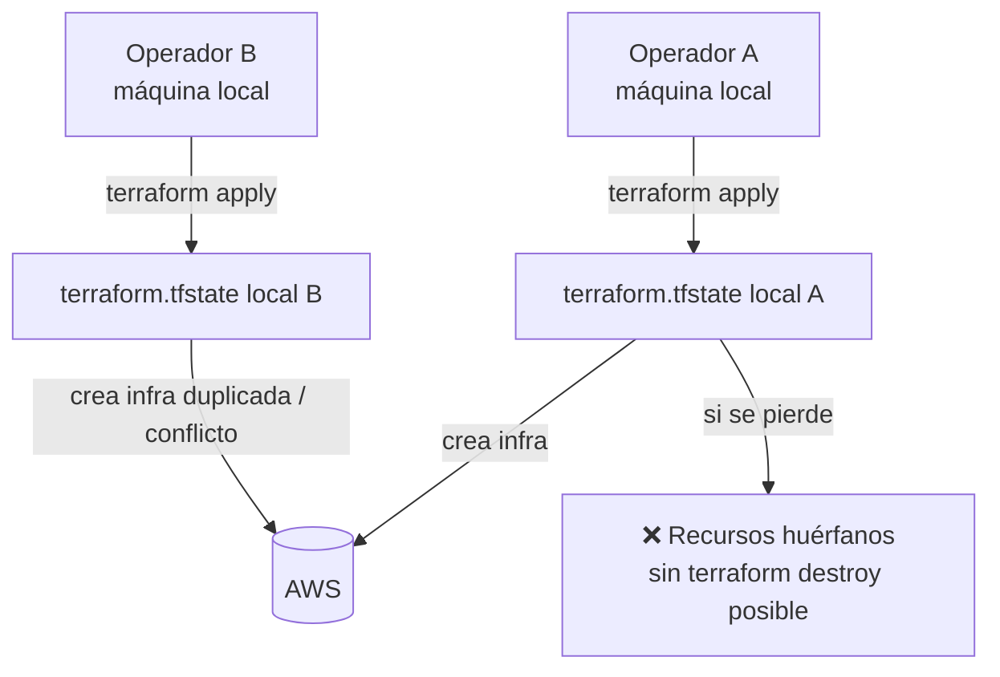

# Infrastructure as Code Assessment

---

## Estado General

| Aspecto | Estado | Observación |
|---------|--------|-------------|
| **Organización** | ⚠️ Parcial | Directorios por proyecto/región, sin módulos reutilizables |
| **Modularización** | ❌ Ausente | ~80% de código duplicado entre gen1 y gen2 |
| **Variables** | ⚠️ Parcial | Usadas, pero con defaults hardcodeados (IDs reales de AWS) |
| **Outputs** | ✅ Presentes | Bien definidos en talabre-linux y Arquitectura_regional |
| **Provider versión** | ✅ Correcto | AWS ~5.0, Terraform >=1.6.0 (gen2), >=1.3.0 (gen1) |
| **Backend remoto** | ❌ **AUSENTE** | Sin S3 backend en ningún módulo |
| **State Locking** | ❌ **AUSENTE** | Sin DynamoDB locking |
| **Versionado infra** | ❌ Ausente | Sin tagging de versiones |
| **Ambientes** | ❌ Ausente | Sin dev/staging/prod |
| **Naming** | ✅ Consistente | Patrón `{project_name}-{recurso}-{region}` bien aplicado |
| **Tagging** | ⚠️ Parcial | Tags presentes pero incompletos |
| **IAM mínimo privilegio** | ⚠️ Parcial | S3 wildcard en talabre-linux (F-08) |
| **Secretos** | ⚠️ Riesgo | VPC IDs, account ID en código (F-04, F-05) |
| **Reproducibilidad** | ⚠️ Parcial | TF reproducible pero sin state remoto |
| **Idempotencia** | ⚠️ Parcial | `null_resource` local-exec no idempotente |
| **lifecycle** | ✅ Parcial | `ignore_changes = [desired_count]` correcto en ECS service |
| **Dependencias** | ✅ Correcto | `depends_on` declarado correctamente |
| **Networking** | ✅ Sólido | VPC Endpoints, sin NAT en gen2, SGs mínimos |
| **Destrucción segura** | ❌ No garantizada | Sin verificación de backup pre-destroy |
| **Recursos huérfanos** | 🔴 Riesgo | Sin state remoto, destroy parcial deja huérfanos |

---

## Análisis por Módulo

### IaC_terraform/Arquitectura_regional/ — ECS Fargate (gen1)

**Propósito:** Infraestructura ECS Fargate original. Presente en el código pero a deprecar.

**Recursos creados:**
- ECS Cluster + Task Definitions (master, agente, autónomo)
- ECS Service para master con Cloud Map DNS
- `null_resource` con PowerShell para lanzar agentes
- `time_sleep` de 4 minutos (hardcodeado)
- VPC Endpoints Interface (ECR, STS, Logs, SSM, SSMMessages, EC2Messages)
- VPC Endpoint Gateway (S3)
- IAM roles y políticas
- CloudWatch Log Groups

**Problemas específicos:**
- `null_resource` con `local-exec` PowerShell (F-09)
- `time_sleep` hardcodeado (F-17)
- `variables.tf` con VPC IDs reales como defaults (F-05)
- `ecs_execution_policy` y `logs_execution` adjuntan la misma política dos veces (duplicado inocuo pero innecesario)

---

### IaC_terraform/ModeloPest/talabre-linux/us-east-1/ — AWS Batch EC2 (gen2, activo)

**Propósito:** Infraestructura AWS Batch EC2 actual. La más madura y correcta.

**Recursos creados:**
- 4 Compute Environments (Spot agents, OD agents fallback, Master OD, Agents OD M/A)
- 4 Job Queues (autonomo, master, agents, agents M/A)
- 4 Job Definitions (autónomo, master, agent, agent-stop)
- 3 Launch Templates (batch general, master, agents) con EBS gp3 cifrado, IMDSv2
- Security Groups (master TCP 4004, batch instances, vpc endpoints)
- VPC Endpoints (ECS, ECS-agent, ECS-telemetry, ECR, Logs, SSM, S3)
- IAM roles (batch_service, batch_instance, task_role)
- CloudWatch Log Groups

**Aspectos positivos:**
- Instancias dedicadas por rol (r6a.xlarge master, c7a.medium agents)
- Spot con SPOT_CAPACITY_OPTIMIZED + múltiples familias
- Timeout nativo en Job Definition (36000s = 10h)
- Retry automático en interrupción Spot (`on_status_reason = "Host EC2 terminated*"`)
- IMDSv2 requerido, EBS cifrado
- `enableExecuteCommand = true` para debug interactivo

**Problemas:**
- IAM task_role S3 con `Resource = "*"` (F-08)
- Sin backend remoto (F-01)

---

### IaC_terraform/ModeloPest/talabre/regional/ — ECS Fargate Talabre (gen1)

Similar a `Arquitectura_regional/` pero específico para el proyecto Talabre. Igual de problemático.

---

### IaC_terraform/ModeloPest/Multiple_Region/ — Prototipo multiregional

**Estado:** Prototipo / experimental. **REQUIERE VALIDACIÓN si está desplegado.**

**Costo potencial si activo:** ~$96/mes solo en NAT Gateways (3 regiones × $32).

Incluye:
- 3 VPCs en us-west-2, us-east-1, us-east-2
- NAT Gateways en cada VPC
- VPC Peering entre regiones
- EC2 master en us-west-2
- ECS Fargate hosts en las 3 regiones
- ECS Container Insights habilitado

---

### IaC_terraform/ModeloPest/unica_region_EC2/ — Prototipo EC2 una región

**Estado:** Prototipo / experimental. **REQUIERE VALIDACIÓN si está desplegado.**

**Costo potencial si activo:** ~$32/mes en NAT Gateway.

Incluye EC2 master + Fargate hosts + App Autoscaling + NAT Gateway en us-west-2.

---

## Problema Principal: Sin Backend Remoto



**Solución requerida:**

```hcl
# backend.tf (añadir a cada módulo activo)
terraform {
  backend "s3" {
    bucket         = "{cuenta}-terraform-state"
    key            = "{proyecto}/{region}/terraform.tfstate"
    region         = "us-east-1"
    dynamodb_table = "terraform-state-lock"
    encrypt        = true
  }
}
```

---

## Duplicación de Código entre Módulos

El 80% de los recursos son idénticos entre `Arquitectura_regional/` y `talabre/regional/`. La principal diferencia es el nombre del proyecto.

**Recursos duplicados:**
- IAM roles y políticas (ecsTaskExecution, task_role, S3 policy, ECR policy, ECS exec policy)
- VPC Endpoints (ECR API, ECR DKR, STS, Logs, SSM, SSMMessages, EC2Messages, S3)
- Security Groups (master, tasks, endpoints)
- CloudWatch Log Groups
- Service Discovery namespace y service

**Impacto:** Un cambio de seguridad (ej. agregar un permiso IAM) debe aplicarse en múltiples `main.tf` manualmente.

**Solución recomendada (post-Fase 0):** Modularización Terraform.

---

## ¿Puede Terraform crear y destruir infraestructura por calibración automáticamente?

**Hoy: NO completamente.** Los bloqueos son:

| Bloqueo | Descripción |
|---------|-------------|
| Sin backend remoto | `destroy` solo funciona si el `terraform.tfstate` local existe y está actualizado |
| `null_resource` PowerShell | Genera side effects no revertibles en `destroy` (gen1) |
| Sin verificación pre-destroy | Resultados pueden perderse si se ejecuta destroy antes del backup |
| MASTER_HOST dinámico | La IP del master se obtiene dinámicamente y no está en el state de Terraform |

**Con los cambios de Fase 0+1, sí sería posible:**

```
terraform init
terraform apply        → infraestructura creada
python calibrate.py    → lanza master + agentes → espera fin
python safe_destroy.py → verifica S3 → backup → terraform destroy
```

---

## Estructura Terraform Recomendada (objetivo)

```
IaC_terraform/
├── modules/
│   ├── batch_pest/          ← CE, queues, job defs, launch templates
│   ├── vpc_endpoints/       ← endpoints interface + gateway
│   ├── iam_batch/           ← roles IAM para Batch
│   └── cloudwatch_groups/   ← log groups
│
├── calibrations/
│   └── {proyecto}/
│       └── {region}/
│           ├── main.tf       ← llama a módulos con variables del proyecto
│           ├── variables.tf  ← sin defaults de IDs reales
│           ├── outputs.tf
│           └── backend.tf    ← backend S3 único por proyecto/región
│
└── shared/
    └── networking/           ← VPC Endpoints compartidos (si múltiples proyectos en misma VPC)
```
