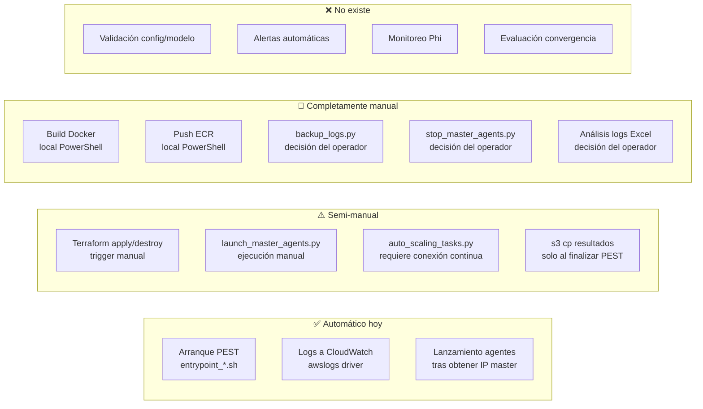

# Automation Assessment

---

## Estado de Cada Etapa del Ciclo de Calibración

| # | Etapa | Estado | Archivo / Mecanismo | Observaciones |
|---|-------|--------|---------------------|---------------|
| 1 | Validar configuración | ❌ NO EXISTE | — | Manual |
| 2 | Validar modelo (.pst, .tpl, .ins) | ❌ NO EXISTE | — | Manual |
| 3 | Validar parámetros PEST | ❌ NO EXISTE | — | Manual |
| 4 | Preparar archivos de ejecución | ❌ NO EXISTE | — | Manual |
| 5 | Construir imagen Docker | 🔴 MANUAL | Script PowerShell | Sin CI/CD |
| 6 | Publicar en ECR | 🔴 MANUAL | `AWS_ECR_carga_imagen_docker.ps1` | Sin automatización |
| 7 | Inicializar Terraform (`terraform init`) | 🔴 MANUAL | CLI local | — |
| 8 | Validar Terraform (`terraform plan`) | 🔴 MANUAL | CLI local | — |
| 9 | Crear infraestructura (`terraform apply`) | 🟡 SEMI-MANUAL | CLI local | Terraform automatiza la creación, pero el trigger es manual |
| 10 | Lanzar Master | 🟡 SEMI-MANUAL | `launch_master_agents.py` | Script existe pero se ejecuta manualmente |
| 11 | Lanzar Workers/Agentes | ✅ AUTO | `launch_master_agents.py` | Automático tras obtener IP del master |
| 12 | Iniciar PEST | ✅ AUTO | `entrypoint_master.sh` | Inicia automáticamente al arrancar el contenedor |
| 13 | Monitorizar ejecución | 🟡 PARCIAL | `auto_scaling_tasks.py` | Requiere conexión manual continua del operador |
| 14 | Capturar métricas de progreso | 🟡 PARCIAL | CloudWatch Logs (texto) | Sin métricas de Phi ni convergencia |
| 15 | Registrar logs | ✅ AUTO | Driver `awslogs` en job definitions | Configurado automáticamente |
| 16 | Guardar resultados en S3 | 🟡 PARCIAL | `entrypoint_master.sh` (s3 cp) | Solo al finalizar PEST; no garantizado en fallos |
| 17 | Evaluar calidad/convergencia | ❌ NO EXISTE | — | Sin análisis de Phi |
| 18 | Generar alertas | ❌ NO EXISTE | — | Sin CloudWatch Alarms ni SNS |
| 19 | Respaldar resultados/logs | 🔴 MANUAL | `backup_logs.py` | Se ejecuta manualmente |
| 20 | Detener workers | 🟡 SEMI-MANUAL | `stop_master_agents.py` | Script existe pero se ejecuta manualmente |
| 21 | Destruir infraestructura | 🔴 MANUAL | `terraform destroy` | Sin verificación pre-destroy |

**Resumen:**
- ✅ Automático: 3 de 21 etapas (14%)
- 🟡 Semi-manual o parcial: 6 de 21 (29%)
- 🔴 Manual / No existe: 12 de 21 (57%)

---

## Intervenciones Manuales Actuales que Podrían Automatizarse

### Alta prioridad

| Intervención | Cómo automatizar | Esfuerzo |
|--------------|-----------------|---------|
| Autoscaler requiere conexión del operador | Mover a Lambda schedulada (CloudWatch Events) | M |
| `terraform apply` manual | Disparado desde orquestador Python o Step Functions | M |
| `terraform destroy` manual | Disparado automáticamente al finalizar calibración (con verificación S3) | M |
| Build y push Docker manual | Pipeline CI/CD (CodeBuild o GitHub Actions) | M |

### Media prioridad

| Intervención | Cómo automatizar | Esfuerzo |
|--------------|-----------------|---------|
| Backup de logs manual | Pre-destroy hook automático | S |
| `launch_master_agents.py` manual | Parte del flujo orquestado (ya existe el script) | S |
| `stop_master_agents.py` manual | Trigger automático al detectar fin de PEST | S |
| Verificación pre-destroy | Script wrapper `safe_destroy.py` | S |

---

## Análisis del Autoscaler

### Funcionamiento actual

El `auto_scaling_tasks.py` implementa la lógica más compleja del sistema:

```
LOOP cada {N} minutos:
  1. Lee variables.tf → región, proyecto
  2. Lee terraform.tfstate → IDs de SG (¡lee state file local!)
  3. Consulta CloudWatch → stream más reciente del master
  4. Busca último log con: "Running model X times" o "Calculating Jacobian matrix"
  5. Extrae N (número de modelos solicitados por PEST)
  6. Lista tareas RUNNING en ECS/Batch
  7. Compara N necesarios vs N activos
     Si N necesario > N activo → lanzar más agentes (via subprocess launch_master_agents.py)
     Si sin cambio → verificar agentes que terminaron → detenerlos
  8. Detiene agentes que:
     - Completaron su corrida ("Model run complete" en logs)
     - Alcanzaron timeout ("MODEL TIMEOUT" en logs)
     - No tienen logs (sin actividad)
  9. Exporta CSV de revisión a log_autoscaling/
```

### Problemas del autoscaler

| Problema | Descripción |
|----------|-------------|
| **Dependencia conexión local** | Loop `while True` en máquina del operador (F-03) |
| **Lee terraform.tfstate local** | Si el state no está actualizado, obtiene IDs incorrectos |
| **Valores hardcodeados** | Log groups, cluster, job queue para talabre-linux (F-07) |
| **Mezcla ECS + Batch** | `get_all_ecs_tasks()` usa API ECS para listar tareas de Batch (funciona pero es inconsistente) |
| **`stop_task()` llama ECS** | Usa `ecs.stop_task()` cuando en Batch la API correcta es `batch.terminate_job()` |
| **Sin manejo de error del master** | No detecta si el master falló y notifica |

### Qué extrae correctamente del log master

```python
find_logs = [
    "Running model",              # inicio de corridas del modelo
    "Calculating Jacobian matrix", # fase de cálculo Jacobiano
    "Parallelisation of lambda search" # búsqueda de lambda paralela
]
find_model_start = "Running model"
find_model_end   = "Model run complete"
find_model_timeout = "MODEL TIMEOUT"
```

**Lo que NO extrae pero podría:**
- `Phi =` o `Objective function value =` (Phi de cada iteración)
- `Iteration X` (número de iteración actual)
- Mensajes de convergencia propios de PEST

---

## Gap de Automatización: diagrama



---

## Objetivo de Automatización

El objetivo de largo plazo es reducir la intervención manual a:

1. **Preparación del modelo** (inevitablemente manual — requiere expertise científico)
2. **Lanzamiento de la calibración** (un único comando)
3. **Decisiones de parada** (solo cuando hay alerta de calidad/costo)

```bash
# Estado futuro objetivo:
python calibrate.py start config/talabre_config.yaml

# Sistema hace automáticamente:
# → valida config → build imagen → push ECR → terraform apply
# → lanza master → lanza agentes → monitorea → alerta si hay problemas
# → al converger: backup → terraform destroy → notifica por email
```
