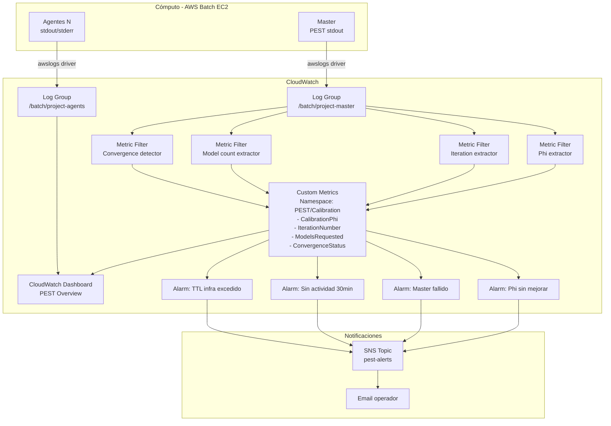

# Observability Assessment

---

## Situación Actual

| Componente | Estado | Ubicación |
|------------|--------|-----------|
| Logs master | ✅ EXISTE | CloudWatch `/batch/{project}-master` |
| Logs agentes | ✅ EXISTE | CloudWatch `/batch/{project}-agents` |
| Métricas CPU/RAM | 📋 REQUIERE VALIDACIÓN | CloudWatch Container Insights (si habilitado en CE) |
| Iteraciones PEST | ❌ NO EXISTE | Solo en logs como texto plano |
| Phi (objective function) | ❌ NO EXISTE | Solo en logs como texto plano |
| Estado de agentes | ⚠️ PARCIAL | `auto_scaling_tasks.py` analiza logs periódicamente |
| Dashboard | ❌ NO EXISTE | Sin CloudWatch Dashboard configurado |
| Alertas | ❌ NO EXISTE | Sin CloudWatch Alarms ni SNS |
| Costo en tiempo real | ❌ NO EXISTE | AWS Cost Explorer post-hoc únicamente |

---

## Información Disponible en Logs del Master (PEST stdout)

Los logs del master en CloudWatch contienen el stdout completo de PEST. A partir de calibraciones previas, el `auto_scaling_tasks.py` demuestra que estas líneas son emitidas:

```
Running model X times .....
Calculating Jacobian matrix: running model X times .....
Parallelisation of lambda search: running model up to X times.....
Model run complete.
```

PEST también emite (REQUIERE VALIDACIÓN con log real):
```
Phi = XXXX.X
Current phi = XXXX.X (Measurement: XXXX.X  Regularization: XXXX.X)
Iteration X
PEST is continuing to try to improve the objective function...
Optimization complete: relative parameter change less than RELPARCHG
```

**Patrón de extracción ya demostrado en el código:**
```python
# auto_scaling_tasks.py ya extrae:
match = re.search(r'model\s+(?:up\s+to\s+)?(\d+)\s+times?', message)
```

El mismo patrón puede extender para capturar Phi, número de iteración, y mensajes de convergencia.

---

## Métricas Extraíbles por Fuente

### Desde logs CloudWatch del master (texto → Metric Filters)

| Métrica | Patrón de extracción | Ejemplo de log |
|---------|---------------------|----------------|
| Phi actual | `Phi\s*=\s*([\d.]+)` | `Phi = 1234.56` |
| Número de iteración | `Iteration[:\s]+(\d+)` | `Iteration: 5` |
| Modelos solicitados | `model\s+(?:up to\s+)?(\d+)\s+times?` | `running model 400 times` |
| Mensaje de convergencia | Contains `RELPARCHG\|PHIREDSTP\|optimization complete` | texto convergencia |
| Modelo completado | Contains `Model run complete` | — |

### Desde AWS Batch API

| Métrica | Cómo obtener | Latencia |
|---------|-------------|---------|
| Jobs RUNNING | `batch.list_jobs(jobStatus='RUNNING')` | Inmediata |
| Jobs FAILED | `batch.list_jobs(jobStatus='FAILED')` | Inmediata |
| Jobs SUCCEEDED | `batch.list_jobs(jobStatus='SUCCEEDED')` | Inmediata |
| Duración del job master | `describe_jobs → startedAt, stoppedAt` | Inmediata |

### Desde CloudWatch Metrics nativas de Batch/EC2

| Métrica | Namespace | Disponibilidad |
|---------|-----------|---------------|
| CPUUtilization master | `AWS/EC2` | Si Container Insights habilitado |
| MemoryUtilization | `AWS/ECS` | Si Container Insights habilitado |
| Número de instancias activas | `AWS/AutoScaling` | Vía Compute Environment |

---

## Arquitectura de Observabilidad Propuesta



---

## Implementación de Metric Filters

Los CloudWatch Metric Filters permiten extraer valores numéricos de líneas de log sin código adicional.

### Ejemplo: extraer Phi

```json
{
  "filterPattern": "[..., text=\"Phi\", eq=\"=\", phi_value, ...]",
  "metricTransformations": [{
    "metricName": "CalibrationPhi",
    "metricNamespace": "PEST/Calibration",
    "metricValue": "$phi_value",
    "dimensions": {
      "Project": "${project_name}"
    }
  }]
}
```

### Ejemplo: detectar convergencia

```json
{
  "filterPattern": "\"optimization complete\"",
  "metricTransformations": [{
    "metricName": "ConvergenceDetected",
    "metricNamespace": "PEST/Calibration",
    "metricValue": "1",
    "unit": "Count"
  }]
}
```

> **REQUIERE VALIDACIÓN:** El formato exacto de las líneas de Phi en los logs del master debe confirmarse con un log real de CloudWatch antes de implementar los Metric Filters.

---

## Widgets del Dashboard Propuesto

```
┌──────────────────────────────────────────────────────────────────────┐
│  PEST CALIBRATION MONITOR — pest-talabre-linux — us-east-1           │
│  Estado: IMPROVING  │  Iteración: 12  │  Tiempo activo: 4h 23m       │
├────────────────────────┬─────────────────────────────────────────────┤
│  Phi Evolution         │  Infrastructure                              │
│  [Line Chart]          │  Master:  ✅ RUNNING                         │
│   Phi ↓ por iteración  │  Agentes: 47 activos / 2 fallidos           │
│                        │  CPU Master: 62%                             │
│                        │  Memoria Master: 78%                         │
├────────────────────────┼─────────────────────────────────────────────┤
│  Modelos ejecutados    │  Recent Alarms                               │
│  [Bar Chart por iter]  │  [Alarm Widget]                              │
├────────────────────────┴─────────────────────────────────────────────┤
│  Recent Logs — Master (últimas 50 líneas)                             │
│  [CloudWatch Logs Insights Widget]                                    │
└──────────────────────────────────────────────────────────────────────┘
```

---

## Prioridad de Implementación

| Prioridad | Componente | Esfuerzo | Valor |
|-----------|------------|---------|-------|
| 1 | CloudWatch Metric Filters (Phi, iteración) | S | ALTO |
| 2 | SNS topic + alarma master fallido | S | CRÍTICO |
| 3 | CloudWatch Dashboard básico | S | ALTO |
| 4 | Alarma sin actividad 30 min | S | ALTO |
| 5 | Alarma TTL infraestructura | S | MEDIO |
| 6 | Container Insights para CPU/RAM | XS | MEDIO |
| 7 | Exportación logs a S3 antes de expirar | XS | MEDIO |
