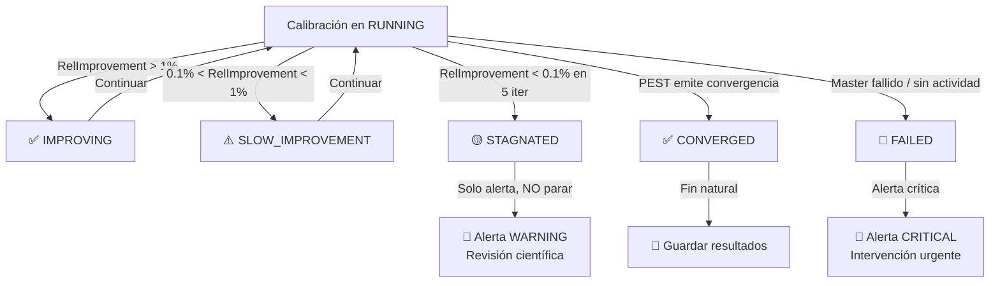

# Calibration Quality Monitoring

---

## ¿Qué es Phi?

**Phi (Φ)** es la función objetivo de PEST. Representa la suma ponderada de residuales al cuadrado entre las observaciones de campo y los valores simulados por el modelo:

```
Φ = Σ wᵢ² · (obs_i - sim_i)²
```

Donde:
- `obs_i` = observación de campo (nivel freático, caudal, concentración, etc.)
- `sim_i` = valor simulado por el modelo para la misma variable/ubicación
- `wᵢ` = peso asignado a la observación (refleja confiabilidad del dato)

**PEST minimiza Φ iterativamente** usando el algoritmo de Levenberg-Marquardt. Una calibración exitosa logra un Phi bajo y estadísticamente aceptable.

### Componentes de Phi en PEST/PEST++

PEST separa Phi en dos componentes:

| Componente | Descripción |
|------------|-------------|
| **Phi medición** | Contribución de las observaciones directas (niveles, caudales, etc.) |
| **Phi regularización** | Contribución de restricciones sobre los parámetros (suavidad, límites) |

```
Phi_total = Phi_medicion + Phi_regularizacion
```

Cuando se usa regularización (común en problemas mal condicionados), es importante monitorear **ambos componentes** por separado, ya que Phi_regularizacion puede estar reduciendo Phi_total sin que el ajuste a observaciones realmente mejore.

---

## ¿Qué Información Genera PEST en sus Logs?

### Confirmado desde el código (`auto_scaling_tasks.py`)

Estas líneas **se sabe que aparecen** en los logs del master:

```
Running model X times .....
Calculating Jacobian matrix: running model X times .....
Parallelisation of lambda search: running model up to X times.....
Model run complete.
```

### Esperado en stdout de PEST HP (REQUIERE VALIDACIÓN con log real)

```
PEST Version 17.5

Iteration 1
Objective function value: 8432.5
  Measurement objective function: 7891.3
  Regularization objective function: 541.2

Calculating Jacobian matrix: running model 400 times .....
...
Model run complete.

Iteration 2
Objective function value: 6234.8
...

PEST is continuing to try to improve the objective function...

Optimization complete: relative parameter change less than RELPARCHG
```

> **ACCIÓN REQUERIDA:** Obtener un log real del master de una calibración anterior para confirmar el formato exacto de las líneas de Phi antes de implementar los Metric Filters.

---

## Métricas de Calidad Propuestas

### Cálculo por iteración

```python
# Phi de la iteración k
Phi_k = phi_extraido_del_log(k)

# Delta absoluto de mejora
DeltaPhi_k = Phi_{k-1} - Phi_k          # positivo = mejoró

# Mejora relativa por iteración
RelImprovement_k = (Phi_{k-1} - Phi_k) / Phi_{k-1}   # si Phi_{k-1} > 0

# Media móvil de mejora relativa (ventana N iteraciones)
SlidingImprovement_N = mean(RelImprovement_{k-N+1 .. k})

# Reducción total acumulada
TotalReduction_pct = (Phi_0 - Phi_k) / Phi_0 * 100
```

---

## Sistema de Clasificación de Estados

### Estados Propuestos

| Estado | Condición | Significado |
|--------|-----------|-------------|
| **IMPROVING** | `RelImprovement_k > 0.01` (>1%) en las últimas 3 iter | Progreso claro y consistente |
| **SLOW_IMPROVEMENT** | `0.001 < SlidingImprovement_3 <= 0.01` | Mejora entre 0.1% y 1% — progreso real pero lento |
| **STAGNATED** | `SlidingImprovement_5 < 0.001` (<0.1% en 5 iter) | Phi prácticamente constante — posible atascamiento |
| **CONVERGED** | PEST emite mensaje de convergencia propio | Convergencia matemática según criterios internos PEST |
| **FAILED** | Job master fallido, sin actualización Phi por >2h | Falla operacional |

### Umbrales Propuestos (para validar experimentalmente)

```yaml
classification:
  improving:
    threshold_relative_improvement: 0.01      # > 1% mejora
    min_iterations_window: 3
    
  slow_improvement:
    threshold_relative_improvement_min: 0.001  # > 0.1%
    threshold_relative_improvement_max: 0.01   # < 1%
    
  stagnated:
    threshold_relative_improvement: 0.001      # < 0.1%
    iterations_window: 5                       # evaluar sobre 5 iteraciones
    
  convergence:
    source: "pest_message_only"  # NO inferir desde umbrales numéricos
    keywords:
      - "RELPARCHG"              # cambio relativo de parámetros
      - "PHIREDSTP"              # reducción de Phi se detuvo
      - "optimization complete"
      - "Optimization complete"
```

> **IMPORTANTE:** Estos umbrales son un punto de partida. Deben calibrarse con calibraciones reales antes de usarlos para decisiones automáticas.

---

## Diferencia Crítica: CONVERGED vs STAGNATED

Esta distinción es fundamental y **no deben tratarse como equivalentes**:

### CONVERGED

- PEST ha detectado internamente que los parámetros **no cambian significativamente** entre iteraciones (criterio `RELPARCHG`), o que Phi se redujo por debajo del umbral `PHIREDSTP`.
- PEST lo **reporta explícitamente** en su stdout.
- Significa que el algoritmo de Levenberg-Marquardt encontró un mínimo (local o global).
- **La calibración terminó correctamente** desde el punto de vista matemático.
- **Acción:** Aceptar los resultados (previa revisión científica del Phi final).

### STAGNATED

- Phi no mejora pero PEST **no ha emitido ningún mensaje de convergencia**.
- Puede indicar: mínimo local, parámetros bloqueados por constraints, modelo con baja sensibilidad a los parámetros, o simplemente una iteración larga con muchas corridas del modelo.
- **La calibración sigue corriendo pero no avanza.**
- **Acción:** Generar alerta para revisión del científico. NO detener automáticamente.



---

## Riesgos de Falsos Positivos y Negativos

| Estado | Falso Positivo | Falso Negativo | Mitigación |
|--------|---------------|----------------|------------|
| **STAGNATED** | PEST ejecuta Jacobiano completo (muchas corridas, Phi no actualiza por tiempo) → parece estancado cuando está trabajando | Una calibración genuinamente estancada no se detecta si el umbral es muy laxo | Verificar si hay corridas de agentes activas antes de clasificar como STAGNATED |
| **CONVERGED** | Si se usa umbral numérico en lugar de mensaje PEST → convergencia prematura falsa | — | Usar SOLO mensajes explícitos de PEST para clasificar CONVERGED |
| **IMPROVING** | Oscilación de Phi (sube y baja) puede mostrar mejora neta en la ventana | — | Usar media móvil sobre N iteraciones, no solo la última |
| **FAILED** | Job master puede estar en cold start y aún no emitir logs | — | Esperar 30 min antes de clasificar como FAILED |

---

## Fase de Validación de Umbrales

**Antes de automatizar cualquier decisión de parada**, los umbrales deben validarse experimentalmente:

### Procedimiento propuesto

1. **Recopilar histórico de calibraciones:** Obtener los logs completos de master de calibraciones anteriores que convergieron exitosamente.

2. **Calcular métricas retroactivamente:** Aplicar el algoritmo de clasificación sobre el histórico para ver qué estados se habrían clasificado y en qué iteraciones.

3. **Comparar con decisiones reales:** Verificar que el sistema habría clasificado correctamente lo que el equipo científico determinó manualmente.

4. **Ajustar umbrales:** Modificar `threshold_relative_improvement` y `iterations_window` hasta que los falsos positivos y negativos sean aceptables.

5. **Solo entonces automatizar alertas.** Las decisiones de parada automática son un paso posterior.

---

## Plan de Implementación

### Fase 2 (corto plazo)
- Implementar extracción de Phi desde logs → CloudWatch Custom Metric
- Calcular `DeltaPhi` y `RelImprovement` por iteración
- Publicar como métricas en CloudWatch

### Fase 3 (mediano plazo)
- Implementar clasificación IMPROVING / SLOW_IMPROVEMENT / STAGNATED / CONVERGED
- Generar alertas informativas (no automatizar parada)
- Validar umbrales con calibraciones reales

### Fase 6 (largo plazo, post-validación)
- Considerar detención automática solo para FAILED (job fallido)
- Para CONVERGED: el sistema puede iniciar el flujo de cierre automáticamente
- Para STAGNATED: solo alerta, nunca parada automática sin aprobación humana
