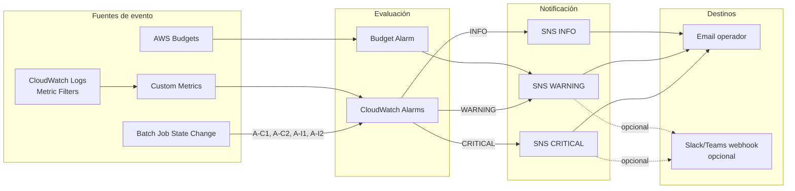

# Alerts Strategy

---

## Principio de Diseño

Las alertas deben ser **accionables**. Cada alerta debe responder a: "¿Qué debe hacer el operador cuando recibe esta alerta?"

**Prioridad de implementación:** CRITICAL primero, luego WARNING, luego INFO.

---

## CRITICAL — Requieren intervención urgente

| ID | Alerta | Condición | Mecanismo | Acción requerida |
|----|--------|-----------|-----------|-----------------|
| A-C1 | **Master fallido** | Job master pasa a `FAILED` o `STOPPED` | CloudWatch Events (Batch job state) → SNS | Revisar logs, decidir si reiniciar calibración completa |
| A-C2 | **Calibración completamente detenida** | Job master en FAILED y sin jobs de agente RUNNING por >30 min | CloudWatch Alarm (Custom Metric AgentsRunning = 0 AND master FAILED) | Verificar causa, ejecutar safe_destroy si no hay resultados válidos |
| A-C3 | **Todos los agentes fallidos** | Agents RUNNING = 0 durante calibración activa por >1h | CloudWatch Alarm sobre Custom Metric | Verificar si master sigue activo, relanzar agentes |
| A-C4 | **Infraestructura activa más de TTL** | Calibración activa por >N horas sin señal de fin | CloudWatch Alarm sobre Custom Metric InfraAge | Verificar estado, ejecutar stop + destroy si corresponde |

---

## WARNING — Requieren revisión pronto

| ID | Alerta | Condición | Mecanismo | Acción recomendada |
|----|--------|-----------|-----------|-------------------|
| A-W1 | **Agente fallido** | Job de agente pasa a `FAILED` (no por interrupción Spot) | CloudWatch Events → SNS | Revisar logs del agente. Si es error sistemático, investigar |
| A-W2 | **Múltiples agentes fallidos** | >5% de agentes activos en FAILED en 30 min | CloudWatch Alarm Custom Metric | Investigar causa común (imagen rota, conectividad, modelo) |
| A-W3 | **Slow improvement** | `SlidingImprovement_3 < 0.01` (menos de 1% en 3 iter) | Custom Metric Alarm | Informar al modelador para evaluación |
| A-W4 | **Calibración STAGNATED** | `SlidingImprovement_5 < 0.001` (menos de 0.1% en 5 iter) | Custom Metric Alarm | Informar al científico — puede ser mínimo local o modelo insensible |
| A-W5 | **Costo mayor al esperado** | Budget alarm > umbral ($X/día o $Y total) | AWS Budgets → SNS | Revisar número de agentes activos, verificar si hay recursos huérfanos |
| A-W6 | **Sin actividad del master** | No hay nuevos logs del master por >30 min durante calibración | CloudWatch Alarm (log metric) | Verificar si PEST está procesando o si hubo fallo silencioso |

---

## INFO — Informativas, sin acción urgente requerida

| ID | Alerta | Condición | Mecanismo |
|----|--------|-----------|-----------|
| A-I1 | **Calibración iniciada** | Job master pasa a `RUNNING` | CloudWatch Events → SNS |
| A-I2 | **Calibración finalizada (éxito)** | Job master pasa a `SUCCEEDED` | CloudWatch Events → SNS |
| A-I3 | **Calibración converged** | Metric Filter detecta mensaje PEST de convergencia | Custom Metric Alarm → SNS |
| A-I4 | **Phi mejoró significativamente** | `RelImprovement > 10%` en última iteración | Custom Metric Alarm → SNS (opcional) |
| A-I5 | **Agentes ajustados** | Autoscaler lanzó o detuvo agentes | Log del autoscaler → CloudWatch → SNS (opcional) |

---

## Implementación Técnica

### CloudWatch Events para cambios de estado en Batch

```json
{
  "source": ["aws.batch"],
  "detail-type": ["Batch Job State Change"],
  "detail": {
    "status": ["FAILED"],
    "jobName": [{ "prefix": "pest-talabre-linux-master" }]
  }
}
```

→ Target: SNS Topic `pest-alerts-critical`

### CloudWatch Alarm para ausencia de logs

```hcl
resource "aws_cloudwatch_metric_alarm" "master_no_activity" {
  alarm_name          = "${var.project_name}-master-no-activity"
  comparison_operator = "LessThanThreshold"
  evaluation_periods  = 3
  metric_name         = "IncomingLogEvents"
  namespace           = "AWS/Logs"
  period              = 600   # 10 minutos
  statistic           = "Sum"
  threshold           = 1
  alarm_description   = "Master sin logs por 30 minutos"
  alarm_actions       = [aws_sns_topic.pest_alerts.arn]
  dimensions = {
    LogGroupName = "/batch/${var.project_name}-master"
  }
}
```

### SNS Topic y suscripciones

```hcl
resource "aws_sns_topic" "pest_alerts" {
  name = "${var.project_name}-alerts"
}

resource "aws_sns_topic_subscription" "email" {
  topic_arn = aws_sns_topic.pest_alerts.arn
  protocol  = "email"
  endpoint  = var.alert_email
}
```

---

## Diagrama de Flujo de Alertas



---

## Clasificación de Alertas por Fase de Implementación

| Fase | Alertas a implementar | Esfuerzo |
|------|-----------------------|----------|
| **Fase 2 (corto plazo)** | A-C1, A-C3 (master fallido, todos los agentes fallidos), A-I1, A-I2 | S |
| **Fase 2 (corto plazo)** | A-W6 (sin actividad 30 min), A-W5 (budget) | S |
| **Fase 3 (mediano plazo)** | A-W3, A-W4 (slow improvement, stagnated) — requiere métricas de Phi | M |
| **Fase 3 (mediano plazo)** | A-I3 (convergencia detectada), A-C4 (TTL infra) | S |
| **Opcional** | A-W1, A-W2 (agentes fallidos individuales) — puede generar ruido | M |

---

## Configuración de Variables de Alerta

Agregar a `variables.tf` de cada proyecto:

```hcl
variable "alert_email" {
  description = "Email para recibir alertas de calibración"
  type        = string
  default     = ""  # NO hardcodear
}

variable "infra_max_ttl_hours" {
  description = "Tiempo máximo de infraestructura activa antes de alertar"
  type        = number
  default     = 48
}

variable "budget_alert_usd" {
  description = "Umbral de costo diario en USD para alerta"
  type        = number
  default     = 50
}
```
