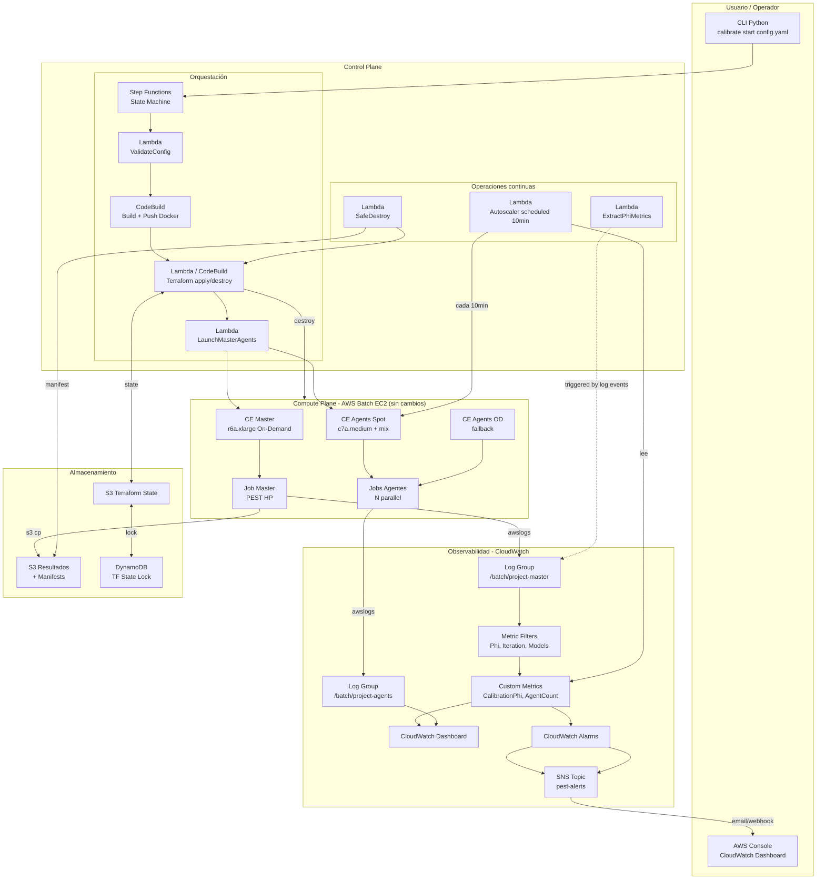

# Target Architecture

---

## Principios de Diseño

1. **Simplicidad primero** — no agregar servicios sin beneficio claro
2. **Automatización** — reducir intervención manual al mínimo
3. **Reproducibilidad** — toda calibración debe ser auditable y repetible
4. **Observabilidad** — estado visible en tiempo real via CloudWatch
5. **Resiliencia** — el sistema continúa sin depender de la laptop del operador
6. **Seguridad** — mínimo privilegio, sin credenciales en código
7. **Costo** — infraestructura efímera, Spot para agentes, sin recursos ociosos
8. **Mantenibilidad** — código modular, sin duplicación

---

## Separación Control Plane / Compute Plane

La arquitectura objetivo separa claramente dos responsabilidades:

| Plano | Responsabilidad | Tecnología |
|-------|----------------|-----------|
| **Control Plane** | Orquestación, monitoreo, alertas, lifecycle de infraestructura | Lambda, Step Functions, CloudWatch |
| **Compute Plane** | Ejecución real de PEST y el modelo numérico | AWS Batch EC2 (sin cambios) |

Esta separación es el cambio más importante: el Compute Plane ya está bien diseñado y no necesita cambios fundamentales.

---

## Diagrama de Arquitectura Objetivo



---

## Componentes y Responsabilidades

### Control Plane

| Componente | Responsabilidad | Tecnología | Cambio vs hoy |
|------------|----------------|-----------|---------------|
| **CLI Python** | Punto de entrada: valida config YAML, inicia Step Functions | Python CLI | Nuevo |
| **Step Functions** | Orquesta el flujo completo; gestiona errores y rollback | AWS Step Functions | Nuevo (Fase 6) |
| **CodeBuild** | Build y push de imagen Docker a ECR | AWS CodeBuild | Reemplaza PowerShell manual |
| **Lambda ValidateConfig** | Valida config YAML y existencia del modelo | Lambda Python | Nuevo |
| **Lambda LaunchMasterAgents** | Submits jobs Batch master + agentes | Lambda Python | Reemplaza script manual |
| **Lambda Autoscaler** | Monitorea logs y escala agentes | Lambda scheduled | Reemplaza `auto_scaling_tasks.py` manual |
| **Lambda ExtractPhiMetrics** | Extrae Phi de logs → Custom Metric | Lambda triggered | Nuevo |
| **Lambda SafeDestroy** | Verifica S3 → genera manifest → terraform destroy | Lambda Python | Reemplaza destroy manual |
| **Terraform** | Crea/destruye infraestructura Batch | Terraform CLI en Lambda/CodeBuild | Sin cambios de lógica, agrega backend remoto |

### Compute Plane (sin cambios fundamentales)

| Componente | Responsabilidad |
|------------|----------------|
| **Batch CE Master** | r6a.xlarge On-Demand para el proceso PEST master |
| **Batch CE Agents Spot** | c7a.medium + mix de familias Spot con OD fallback |
| **Job Master** | Ejecuta `entrypoint_master.sh` → PEST HP → S3 upload |
| **Job Agents** | Ejecuta `entrypoint_agent.sh` → agent_hp → conecta TCP 4004 |

### Observabilidad

| Componente | Responsabilidad |
|------------|----------------|
| **CloudWatch Logs** | Captura stdout/stderr de master y agentes (ya existe) |
| **Metric Filters** | Extrae Phi, iteración, modelos de logs del master |
| **Custom Metrics** | `PEST/Calibration` namespace con métricas clave |
| **CloudWatch Dashboard** | Visor en tiempo real del progreso |
| **CloudWatch Alarms** | Detecta condiciones de alerta |
| **SNS** | Notifica al operador por email o webhook |

### Almacenamiento

| Componente | Responsabilidad |
|------------|----------------|
| **S3 Resultados** | Modelo final, logs exportados, Calibration Manifest (ya existe) |
| **S3 Terraform State** | Backend remoto con versionado habilitado (nuevo) |
| **DynamoDB** | Locking del state Terraform (nuevo) |

---

## Flujo de Datos

```
config.yaml
    ↓ (CLI)
Step Functions → valida → build → deploy infra → launch
                                                     ↓
                                              [Compute Plane]
                                         Master ←→ Agentes TCP 4004
                                              ↓
                                         CloudWatch Logs
                                              ↓
                                    Metric Filters → Custom Metrics
                                              ↓
                                    CloudWatch Dashboard (visible en tiempo real)
                                    CloudWatch Alarms → SNS → Email
                                              ↓
                                    [Calibración converge o se detiene]
                                              ↓
                                    SafeDestroy: verificar S3 → manifest → destroy
```

---

## Decisiones Arquitectónicas

| Decisión | Alternativa considerada | Razón elegida |
|----------|------------------------|---------------|
| Lambda para autoscaler | ECS Fargate task persistente | Menor costo ($0 cuando no hay calibración) |
| CloudWatch Dashboard como visor | Grafana managed | Menor costo y mantenimiento, acceso ya existe via IAM |
| Step Functions para orquestación | AWS CodePipeline | Mayor flexibilidad, mejor manejo de errores, integración nativa con Batch |
| Backend S3 para state | Terraform Cloud | Sin dependencia de servicio externo, control total |
| Batch EC2 para cómputo | Mantener ECS Fargate | Mejor performance CPU single-thread, Spot nativo, menor costo |
| SNS para alertas | PagerDuty / OpsGenie | Simplicidad, costo mínimo, sin dependencia externa |

---

## Fases de Implementación hacia la Arquitectura Objetivo

| Fase | Cambios principales | Arquitectura resultante |
|------|---------------------|------------------------|
| **Hoy** | Batch EC2 gen2 + scripts manuales | Funcional pero manual |
| **Fase 0** | Bug fixes + seguridad básica | Batch EC2 más seguro y estable |
| **Fase 1** | Backend TF remoto + autoscaler Lambda + deprecar gen1 | Menos dependencia manual |
| **Fase 2** | Metric Filters + Dashboard + Alertas SNS | Observable |
| **Fase 3** | Clasificación calidad (Phi) + alertas warning | Observable + informativo |
| **Fase 4** | Dashboard completo | Visor completo |
| **Fase 5** | Manifest + tags versionados | Reproducible |
| **Fase 6** | Step Functions + CLI + SafeDestroy | **Arquitectura objetivo completa** |
