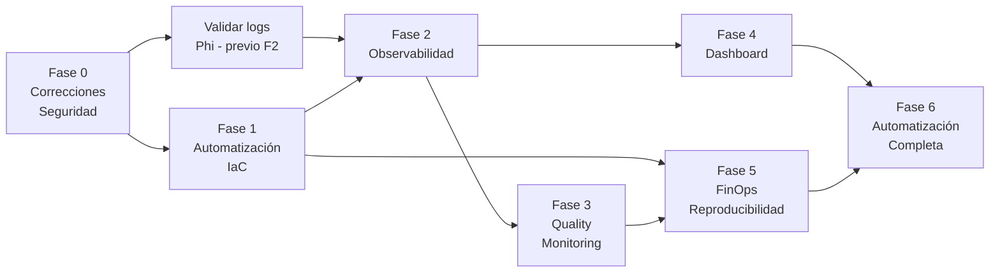

# Roadmap de Mejoras

> Plan de implementación por fases, ordenado por prioridad y dependencias.

---

## Resumen de Fases

| Fase | Nombre | Foco | Esfuerzo total |
|------|--------|------|----------------|
| **0** | Correcciones críticas y seguridad | Estabilidad y mínimo privilegio | XS–S |
| **1** | Automatización IaC y ejecución | Reducir pasos manuales | S–M |
| **2** | Observabilidad y métricas | Visibilidad en tiempo real | S |
| **3** | Quality / Convergence Monitoring | Métricas científicas de PEST | M–L |
| **4** | Dashboard / Visor | Visualización operacional | S |
| **5** | Optimización de costos y reproducibilidad | FinOps + Manifests | S–M |
| **6** | Hardening, resiliencia y automatización completa | Operación autónoma | M–XL |

---

## FASE 0 — Correcciones Críticas y Seguridad

> **Objetivo:** Corregir riesgos activos antes de implementar nuevas funcionalidades.  
> **Duración estimada:** 1–2 sprints

| ID | Iniciativa | Finding ref. | Prioridad | Esfuerzo | Quick Win | Riesgo |
|----|------------|-------------|-----------|---------|-----------|--------|
| 0.1 | Configurar backend S3 + DynamoDB para módulos activos | F-01 | 🔴 CRÍTICA | S | ✅ | Bajo |
| 0.2 | Corregir bug `$RETRY_CODE` → `$EXIT_CODE` en entrypoint_agent.sh | F-02 | 🔴 CRÍTICA | XS | ✅ | Bajo |
| 0.3 | Agregar `#!/bin/bash` y `set -e` a entrypoints sin shebang | F-13 | 🟠 ALTA | XS | ✅ | Bajo |
| 0.4 | Restringir S3 Resource de `*` al bucket específico en talabre-linux | F-08 | 🟠 ALTA | XS | ✅ | Bajo |
| 0.5 | Mover VPC IDs y account ID a `.tfvars` (excluir de git) | F-04, F-05 | 🟠 ALTA | XS | ✅ | Bajo |
| 0.6 | Verificar en consola AWS si NAT Gateways de prototipos están activos | F-18 | 🟡 MEDIA | XS | ✅ | Bajo |
| 0.7 | Tags de Cost Allocation (CalibrationID, Environment) | F-22 | 🔵 BAJA | XS | ✅ | Bajo |

**Dependencias:** Ninguna — puede empezar inmediatamente.

---

## FASE 1 — Automatización IaC y Ejecución

> **Objetivo:** Reducir intervenciones manuales. Mover el autoscaler fuera de la laptop del operador.  
> **Dependencias:** Fase 0 completada.

| ID | Iniciativa | Finding ref. | Prioridad | Esfuerzo | Quick Win | Riesgo |
|----|------------|-------------|-----------|---------|-----------|--------|
| 1.1 | Parametrizar `auto_scaling_tasks.py` (leer desde variables.tf) | F-07 | 🟠 ALTA | S | ✅ | Bajo |
| 1.2 | Mover autoscaler a Lambda schedulada (CloudWatch Events) | F-03 | 🟠 ALTA | M | NO | Medio |
| 1.3 | Eliminar `null_resource` PowerShell de Terraform gen1 | F-09 | 🟠 ALTA | S | ✅ | Bajo |
| 1.4 | Script `safe_destroy.py` — verificar S3 antes de terraform destroy | F-10 | 🟠 ALTA | S | ✅ | Bajo |
| 1.5 | Deprecar y archivar generación ECS Fargate | F-06 | 🟡 MEDIA | S | ✅ | Bajo |
| 1.6 | Modularizar Terraform (módulos: vpc_endpoints, batch_compute, iam) | — | 🟡 MEDIA | M | NO | Bajo |
| 1.7 | Unificar dependencias Python en `pyproject.toml` | F-12 | 🟡 MEDIA | XS | ✅ | Bajo |
| 1.8 | Deprecar código Python muerto (ECS legacy) | F-20, F-21 | 🔵 BAJA | S | ✅ | Bajo |

**Dependencias:** 0.1 (backend remoto requerido antes de modularizar TF)

---

## FASE 2 — Observabilidad y Métricas

> **Objetivo:** Visibilidad del estado de la calibración en tiempo real.  
> **Dependencias:** Fase 0 completada. REQUIERE VALIDACIÓN del formato de logs Phi.

| ID | Iniciativa | Finding ref. | Prioridad | Esfuerzo | Quick Win | Riesgo |
|----|------------|-------------|-----------|---------|-----------|--------|
| 2.1 | Validar formato de líneas Phi en logs reales del master | F-16 | 🔴 PREVIA | XS | ✅ | Bajo |
| 2.2 | CloudWatch Metric Filters para Phi e iteración | F-16 | 🟠 ALTA | S | ✅ | Bajo |
| 2.3 | CloudWatch Custom Metrics (namespace PEST/Calibration) | F-16 | 🟠 ALTA | S | ✅ | Bajo |
| 2.4 | SNS Topic + alerta CRITICAL master fallido | — | 🔴 CRÍTICA | S | ✅ | Bajo |
| 2.5 | CloudWatch Alarm: sin actividad en logs master por 30 min | — | 🟠 ALTA | S | ✅ | Bajo |
| 2.6 | CloudWatch Alarm: presupuesto superado (Budget Alert) | F-18 | 🟡 MEDIA | XS | ✅ | Bajo |
| 2.7 | Alarma TTL: infraestructura activa más de N horas | — | 🟡 MEDIA | S | NO | Bajo |
| 2.8 | Habilitar Container Insights en Compute Environments | — | 🔵 BAJA | XS | ✅ | Bajo |

**Dependencias:** 2.1 debe completarse antes de 2.2 y 2.3.

---

## FASE 3 — Quality / Convergence Monitoring

> **Objetivo:** Clasificar el estado científico de cada calibración.  
> **Dependencias:** Fase 2 completada (Custom Metrics de Phi disponibles).

| ID | Iniciativa | Prioridad | Esfuerzo | Quick Win | Riesgo |
|----|------------|-----------|---------|-----------|--------|
| 3.1 | Lambda ExtractPhiMetrics: calcular DeltaPhi y RelImprovement | 🟠 ALTA | M | NO | Medio |
| 3.2 | Clasificación IMPROVING / SLOW_IMPROVEMENT / STAGNATED / CONVERGED | 🟠 ALTA | M | NO | Medio |
| 3.3 | Alerta WARNING para STAGNATED | 🟡 MEDIA | S | NO | Bajo |
| 3.4 | Alerta INFO para CONVERGED (detectado desde mensaje PEST) | 🟡 MEDIA | S | NO | Bajo |
| 3.5 | Validación experimental de umbrales con calibraciones históricas | 🟠 ALTA | L | NO | Alto |

**Nota sobre 3.5:** Esta iniciativa es larga pero crítica. Los umbrales deben calibrarse con datos reales antes de usarlos para decisiones operacionales.

---

## FASE 4 — Dashboard / Visor

> **Objetivo:** CloudWatch Dashboard completo y visual del progreso.  
> **Dependencias:** Fase 2 completada.

| ID | Iniciativa | Prioridad | Esfuerzo | Quick Win |
|----|------------|-----------|---------|-----------|
| 4.1 | CloudWatch Dashboard básico (Phi + infra + logs) | 🟠 ALTA | S | ✅ |
| 4.2 | Dashboard completo (todos los widgets propuestos en doc 11) | 🟡 MEDIA | S | NO |
| 4.3 | Evaluar necesidad de visor web propio | 🔵 BAJA | S | NO |

---

## FASE 5 — Optimización de Costos y Reproducibilidad

> **Objetivo:** FinOps + trazabilidad completa de cada calibración.  
> **Dependencias:** Fase 1 completada.

| ID | Iniciativa | Prioridad | Esfuerzo | Quick Win |
|----|------------|-----------|---------|-----------|
| 5.1 | Tags versionados de imagen Docker (commit SHA) | 🟠 ALTA | XS | ✅ |
| 5.2 | Calibration Manifest automático al finalizar | 🟠 ALTA | M | NO |
| 5.3 | Exportar logs CloudWatch a S3 antes de expirar | 🟡 MEDIA | XS | ✅ |
| 5.4 | Política ECR lifecycle (eliminar imágenes antiguas) | 🔵 BAJA | XS | ✅ |
| 5.5 | VPC Endpoints compartidos entre proyectos en misma VPC | 🔵 BAJA | M | NO |
| 5.6 | Rightsizing de instancias master por modelo | 🟡 MEDIA | S | NO |

---

## FASE 6 — Hardening, Resiliencia y Automatización Completa

> **Objetivo:** Flujo end-to-end completamente automatizado.  
> **Dependencias:** Fases 1–5 completadas.

| ID | Iniciativa | Prioridad | Esfuerzo | Quick Win |
|----|------------|-----------|---------|-----------|
| 6.1 | CLI Python `calibrate start config.yaml` | 🟠 ALTA | M | NO |
| 6.2 | Step Functions State Machine orquestadora | 🟡 MEDIA | XL | NO |
| 6.3 | CodeBuild para build y push Docker (reemplaza PowerShell) | 🟠 ALTA | M | NO |
| 6.4 | Tests unitarios para scripts Python críticos | 🟡 MEDIA | M | NO |
| 6.5 | Módulo Python compartido `calibration_utils/` | 🟡 MEDIA | S | NO |
| 6.6 | CI/CD pipeline completo (lint + test + build + push) | 🔵 BAJA | M | NO |
| 6.7 | Migrar a ubuntu:24.04 LTS en Dockerfiles | 🟡 MEDIA | S | NO |

---

## Vista de Dependencias

---

## Métricas de Éxito por Fase

| Fase | Métrica de éxito |
|------|-----------------|
| Fase 0 | 0 recursos huérfanos por pérdida de state; bug F-02 corregido |
| Fase 1 | Autoscaler corre sin laptop del operador; destroy seguro funciona |
| Fase 2 | Phi visible en CloudWatch en tiempo real; alerta de master fallido operativa |
| Fase 3 | Clasificación de calibración histórica con <10% falsos positivos |
| Fase 4 | Dashboard muestra estado completo sin abrir CloudWatch Logs manualmente |
| Fase 5 | Toda calibración genera un Manifest con digest de imagen |
| Fase 6 | `calibrate start config.yaml` ejecuta el flujo completo sin intervención manual |
